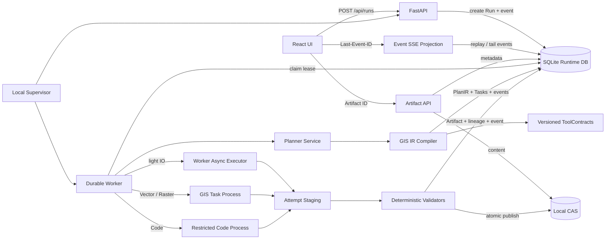
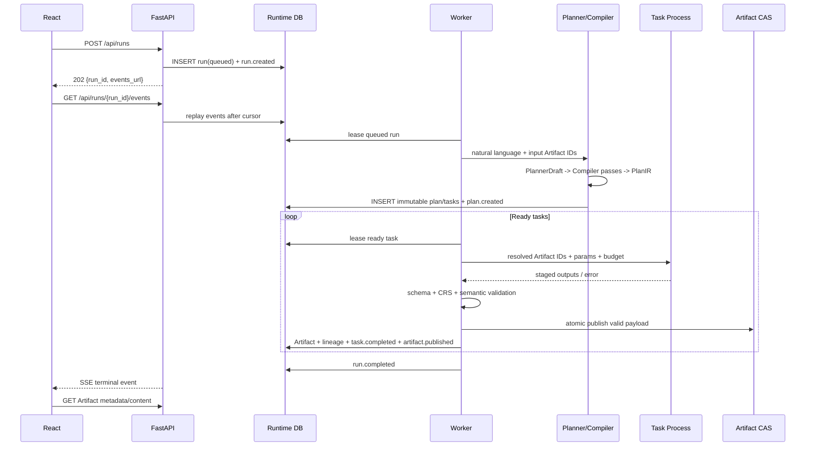
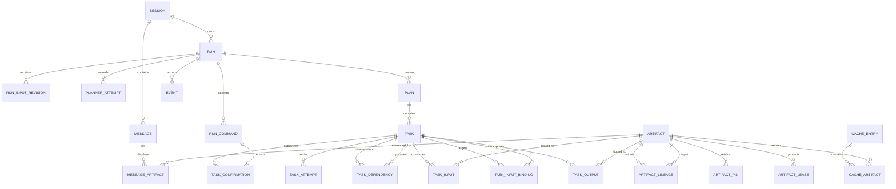
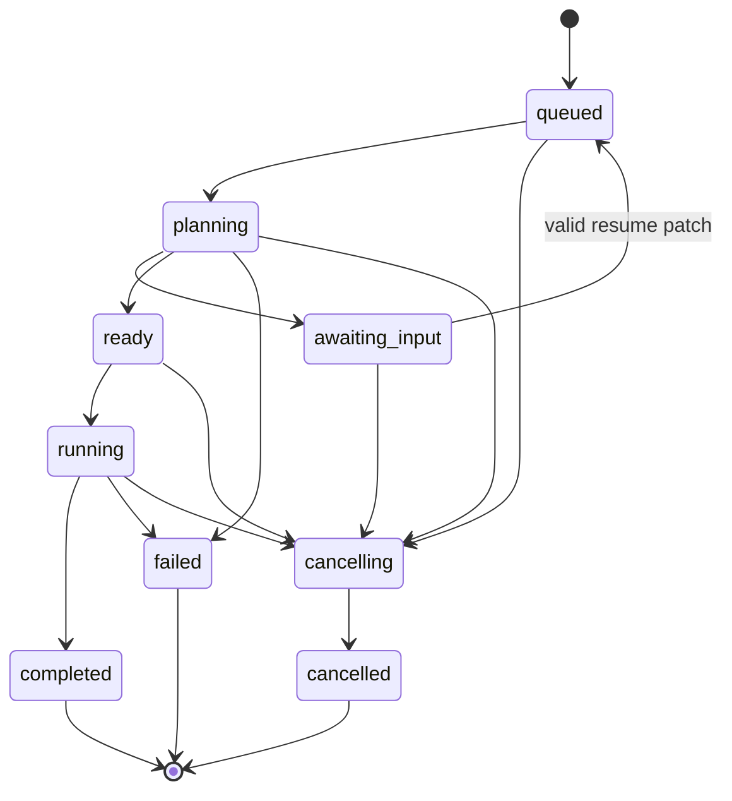
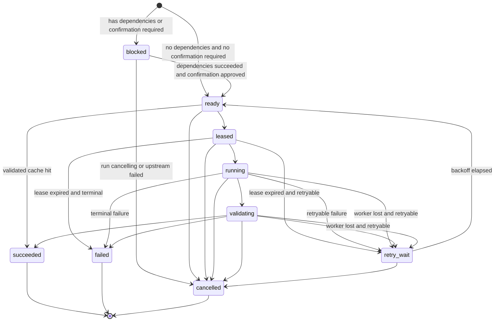

# Gismind GIS Runtime 技术架构与实施规格

> 文档状态：Runtime 主链已实施；未标注“已实施”的条目仍是后续规格
> 文档版本：1.16
> 日期：2026-10-16
> 适用范围：Gismind 单机版下一代运行内核
> 兼容策略：破坏性升级，不兼容旧会话、旧 checkpoint、旧 TaskPlan 与旧 SSE 传输契约

## 阅读约定

本文同时描述三种状态，必须严格区分：

- **当前实现**：以 `backend/`、`frontend/` 与当前测试代码为事实来源。
- **目标规格**：本文定义的 GIS Runtime 行为；在代码落地并通过验收前，不得写成“已经支持”。
- **迁移中间态**：只允许为了分阶段交付而短期存在；最终不得保留两套调度、产物或运行事实语义。

截至本版本，`app.runtime`、`app.api.runtime` 和 Runtime-only 前端是唯一公开主链；旧 Agent 主链已删除并由 [`runtime_removal_manifest.json`](./runtime_removal_manifest.json) 记录。第 2.2 节保留的是删除前的设计驱动审计，不可被当作现状。

`docs/v1/` 是上一代 Agent 架构的历史归档，其中的 [v1 主技术文档](./v1/GIS_Agent_技术文档.md) 不再作为新 Runtime 的当前事实来源。

---

## 1. 执行摘要

Gismind 已完成从 Agent 应用到 GIS Runtime 的主链切换：Run、Input Revision、PlanIR、Task、Artifact 和 Event 由 Runtime SQLite/CAS 管理，Worker 以租约调度任务，SSE 只投影持久化事件。真实 LLM 只在规划阶段产生最小 Draft，不能直接执行 GIS 工具或修改运行状态。

下一代 Gismind 的技术定位是：

> **Agent-driven GIS Runtime：LLM 负责把自然语言编译成计划，可靠性由类型化空间产物、确定性编译、可隔离执行和持久化事件保证。**

新 Runtime 由四个统一抽象组成：

1. **Artifact**：不可变、带类型、带 CRS、可验证、有血缘的空间产物。
2. **GIS IR**：经 ToolContract 补全和静态检查后的正式可执行中间表示。
3. **Durable Executor**：以 SQLite 租约调度、以独立进程隔离高风险 GIS 计算的本地执行机。
4. **Event Log**：与状态变更同事务提交、可按游标重放的运行事件账本；SSE 只是它的投影。

### 1.1 技术栈结论

| 技术 | 决策 | 新职责 |
|---|---|---|
| React 18 + Vite | 保留 | 会话、运行时间线、地图与 Artifact 消费 |
| FastAPI | 保留 | Run/Artifact/Session API 与 Event SSE 投影 |
| GeoPandas/Shapely/Rasterio | 保留 | 确定性 GIS ToolContract handler |
| SQLite | 升级为核心事实库 | Run、Plan、Task、Artifact 元数据、Event、Session、Cache |
| 本地文件系统 | 升级为 CAS | GeoParquet、Parquet、GeoTIFF、JSON、原始文件载荷 |
| 子进程 + Windows Job Object | 泛化 | Vector、Raster、Code Task 的硬隔离、超时和资源限制 |
| Redis | 移除 | 不再保存会话、上传、等待输入或缓存 |
| LangGraph/SqliteSaver | 从主链移除 | 不再承担计划、调度、恢复或运行事实 |
| Celery | 移除 | 单机 Runtime 不引入外部分布式队列 |
| SSE | 保留但降级为传输层 | 从持久化 Event Log 重放并追尾 |

### 1.2 已实施边界与未完成边界

已实施且有当前代码/测试证据的部分是 Runtime Store/CAS、PlanIR Compiler、fenced Planner Worker、独立 GIS 子进程、Run/Artifact/Event API、SSE replay、Runtime-only React UI、旧主链删除门禁，以及 `OpenAICompatiblePlanner` 的真实模型调用、一次受控修复、端口类型约束 catalog 与 action harness。

本文仍保留的运维命令、完整多工具语义提示、细粒度并发预算、备份/GC 策略等，若未在当前代码中出现，应理解为锁定的后续规格而非已发布能力。不得把规格示例反写成现状声明。

### 1.3 2026-09-05 语义加固增量（当前实现）

本次不是增加新的 Agent 或 mock 路径，而是为现有 Runtime 补上可验证的执行闭环。以下结论均有当前代码与本次回归证据：

| 闭环 | 当前实现证据 | 已消除的错误形态 |
|---|---|---|
| 具名 Vector 合同与参数下传 | `backend/app/runtime/contracts.py::ToolContractRegistry.with_builtins`、`tool_handlers.py::_make_method` | `keep_fields`、`dissolve` 等不再因泛化 adapter 丢失字段/分组参数；双输入操作声明真实端口。 |
| CRS 物理坐标一致性 | `tool_handlers.py::_gdf_crs`、`handle_geo_transform`、`handle_vector_convert_datum` | Artifact 的 EPSG 元数据不再被默认为 4326；同 CRS 转换为 identity；Vector datum 转换覆盖整个 FeatureCollection。 |
| Vector 空间输出 CRS 闭环 | `runtime/tool_handlers.py::_coerce_vector_output`、`runtime/executor.py::_validate_vector_payload_crs` | Runtime 空间操作默认保持输入 CRS；GeoJSON 载荷记录并校验物理 CRS/GCJ02 datum 标记，禁止 GCJ02 坐标在继承的 EPSG:4326 元数据下发布；datum 转换仍须显式使用 `vector.convert_datum`。 |
| CSV 完整 Table 与预览分离 | `tools/data_io.py::load_csv/csv_to_points` | `io.load_csv` 同时提供完整 `rows`、`row_count` 和仅供展示的 `sample`；`io.csv_to_points` 只消费并核对完整 rows，避免预览截断。 |
| Artifact 输出基数协议 | `runtime/output_protocol.py`、`runtime/executor.py::_output_items` | 普通 list 始终是一个 payload（包括 Table 行列表）；只有显式 `ArtifactBatch` 才展开为 many Artifacts。 |
| 度量几何正确性 | `tools/spatial_analysis.py::centroid_layer` | 质心先选择局部 UTM 投影计算，再变换回 WGS84/GCJ02；不再直接对经纬度求平面质心。 |
| Raster 与 MapLayer 载荷保真 | `tool_handlers.py::handle_io_load_raster`、`_make_raster`、`handle_map_build`、`artifacts.py::_validate_artifact_content` | GeoTIFF bytes 可跨 Artifact 边界被 Rasterio 重开；MapLayer 固定为 `{layers,bbox,crs}`，前端可直接消费。 |
| Raster 多输入合同 | `contracts.py::ToolContractRegistry.with_builtins`、`tool_handlers.py::handle_raster_*` | `clip_mask(raster,mask)`、`zonal_statistics(raster,zones)`、`sample(raster,points)`、`vectorize(vector,...)`、`polygonize(raster)` 使用具名类型端口；统计 Feature 输出被规范化为 Table 行。 |
| Raster Vector 输出语义 | `contracts.py::ToolContractRegistry.with_builtins`、`tool_handlers.py::handle_raster_contour` | `raster.contour` 明确声明 `Raster -> Vector`，GeoDataFrame 在 handler 边界转为 FeatureCollection，不再把等高线误发布为 Raster。 |
| Raster 派生载荷与 CRS 对齐 | `tools/raster_analysis.py::{terrain_ruggedness_index,topographic_position_index,roughness}`、`tool_handlers.py::{_vector_for_raster,handle_raster_vectorize}` | TRI/TPI/roughness 现在先写可由 Rasterio 重开的 GeoTIFF；Raster mask/zonal/sample/vectorize 先处理 GCJ02 语义再对齐栅格物理 CRS，避免 PNG 元数据落入 Raster Artifact 或跨投影采样/栅格化漂移。 |
| 报告型 Vector 操作 | `contracts.py::ToolContractRegistry.with_builtins`、`tool_handlers.py::handle_vector_check_validity` | `vector.check_validity` 输出 `Table` issue report，而不是会被 Raster/Vector 载荷校验拒绝的伪 Vector。 |
| File 声明元数据闭环 | `api/runtime.py::upload_runtime_artifact`、`tool_handlers.py::{_validate_declared_file_metadata,_io,handle_io_load_raster}` | 上传的 declared_crs/bbox 以 `schema.file` 的 `source=user` wrapper 持久化；`io.load_vector/io.load_raster` 解析后交叉校验 CRS/边界，冲突以 `DECLARED_METADATA_MISMATCH` 失败。 |
| 直接血缘、Blob/Artifact 身份分离 | `executor.py::_input_artifact_ids`、`ArtifactStore.publish_staged`、`migrations.py::_v11_separate_artifact_identity_from_blob_hash` | 输出记录实际输入 Artifact，identity 输出不产生自环；CAS hash 只标识字节，`art_*` 标识不可变语义 Artifact，同一 bytes 可安全拥有不同 type/CRS/schema。 |
| Worker/Planner 终态 | `queue.py::RuntimeSupervisor._finalize_run_if_terminal`、`_call_planner_with_lease_heartbeat`、`_require_executable_draft` | 业务 Task 错误不杀死 Worker；全终态 Run 正确变为 `failed`；慢 Planner 不丢 lease，提交前有同步续租边界；任何 initial/repair `needs_clarification` 都进入 `awaiting_input`，不生成空 Plan。 |
| 前端暂停交互 | `frontend/src/components/ChatPanel.tsx`、`frontend/src/hooks/useRuntimeRun.ts` | `awaiting_input` 时 composer 保持可用，用户可发送 resume patch；取消结果未知时明确输入“重试/retry”会形成 `task_decisions`。SSE reducer 投影 `ready/leased/running/validating/retry_wait/awaiting_input` 等标准 Task 中间状态；MapLayer 通过 Artifact API 获取。 |

本次针对上述闭环运行：后端完整套件 **701 passed, 5 skipped, 78 warnings**；Runtime 聚焦套件 **334 passed, 4 skipped, 37 warnings**；前端 `npm run typecheck` 与生产构建均通过；`python -m app.runtime.gate --phase post-delete` 通过。随后新增上传声明元数据、Raster 载荷/跨 CRS 采样与栅格化、Vector 空结果和 validity Table 合同回归，目标套件当前为 **53 passed, 13 warnings**。真实 provider 垂直验收与 2026-09-05 的 200 条盲意图数字属于旧的 alias 派生 corpus 历史记录；该 corpus 已由独立静态业务意图文件替代，不能作为当前 corpus 的证据。新的静态 corpus 本次未调用真实 provider，后续运行必须保存新的外部报告。warning 主要来自 pyproj、GeoPandas、Rasterio/Matplotlib；原先“直接在 geographic CRS 求质心”的正确性 warning 已消除，其余应在发布质量治理中单独收敛。上述数字是历史本地回归，不替代第 13 章规定的持续发布门禁。

SQLite migration v11 已移除 `artifacts.content_hash` 的唯一约束，保留所有子表对 `artifact_id` 的外键，并增加普通 content-hash 索引。旧行的历史 ID 不会被重写；新上传生成随机 `art_*` ID，Task 输出生成由 producer/port/语义决定的稳定 `art_*` ID，因而 retry 可以幂等。CAS 仍按 SHA-256 去重。GC 以 Blob 可达性补充 Artifact 可达性：只要任一共享同 hash 的 Artifact 被引用或该 hash 有有效 lease，整组都不会进入候选。除已收紧的高风险 Vector 和 Raster 多输入合同外，剩余操作仍需逐项完成端口、参数与语义验证覆盖，不能仅因有 handler 就标记为语义闭合。

---

### 1.4 2026-10-16 Runtime 与真实地图验收增量（当前实现）

当前 Runtime 由 `planning_control.py` 对一次规划 generation 的期限、HTTP 调用预算、lease 失效和 Worker 退出统一控制；`goal_requirements.py` 将用户明确表达的字段保留、重命名、否定筛选、顺序缓冲和多指令要求绑定到 Compiler 检查，不能用模型自行改写的 DAG 反证用户要求。`aggregate_postconditions.py` 对分组、聚合和空间关系输出做独立完整性检查。API、持久化进度投影和前端任务详情补齐运行进度、终态诊断及地图加载失败后的恢复，仍以 SQLite/Event 为运行事实来源。

2026-10-14 的独立中文浏览器 corpus `zh-browser-2000-20261014-batch09` 已完成真实 **2000 个唯一中文请求、2000 个 Provider 验证结果、0 个失败**，最终交付包括 1800 个 GPKG、1800 个 MapLayer 和 200 个 Raster。这里的 2000 条 browser corpus 与阶段 8 的静态 200 条 action corpus 是两套不同验收，不能互相冒充新实测。

2026-10-16 已完成全部 **1800 个最终 MapLayer 的真实 Chrome 验收及独立复核**：独立 GDAL/OSR 读取关联 GPKG，对 5800 个要素（2400 个 Polygon、3400 个 Point，197800 个物理坐标位置）转换并核对；真实 SDK `getPath/getPosition` 的顶点、环和部件逐项匹配；逐 overlay 与最终组合执行隐藏／显示／隐藏／显示，复核独立投影 mask、core、轮廓、锁定视图背景稳定及最终恢复。独立复核覆盖 35804 次 SDK 快照、3764612 次 SDK 坐标位置和 30404 张因果阶段 PNG；最大坐标分量误差约 `5.0e-7°`，低于 `2e-6°` 容差。paint 与 cleanup 仍分别使用原 30 秒期限。

最终状态为 **`COMPLETE_WITH_RETEST`，不是首轮零失败**。完整 full07 首轮为 1799/1800；上一案例发出的 SDK 请求延迟返回时被观测器错误归给当前案例。观测器现按原始 Playwright Request 对象保存归属，不按响应到达时的 UI 状态猜测。修复后在新目录重跑受影响的整个隔离浏览器上下文，25/25 通过；最终选择原轮次未受影响的 1775 个案例和新轮次的 25 个案例，统一复核全部 1800 个不同案例的物理数据、SDK、画面与关闭后的 Native 网络来源。原轮次的失败结果未改写，没有拼入旧 pilot 或旧部分运行。保留的一次画面未就绪测量及随后成功测量也未删去。

本次最终回归为后端 **2999 passed、6 skipped**，前端 **174 passed**，验收工具 **924 passed**；前端 typecheck、生产构建、包体检查及 Runtime post-delete gate 均通过。地图验收不新增 Provider 调用；总预算占用为 `15.818015508 / 20 USD`，其中已结算 `15.382683108 USD`，预留 `0.4353324 USD`。历史案例读取使用隔离只读 clone 及明确标识的历史会话投影；这不表示 stock `/api/sessions` 的 recent-200 列表限制已被取消。

可维护的验收源码位于 `tools/map_acceptance/`，独立物理、PNG 与 Native 复核入口位于其 `review/` 子目录。当前验收摘要为 [`map_acceptance_20261016.json`](./map_acceptance_20261016.json)；大型原始运行证据保存在忽略的 `backend/.gismind/`，不提交进源码仓库。旧重复运行、废弃工具和可重建测试缓存已清理，当前原始数据、full07 与修复后重测结果保留。

## 2. 现状审计

### 2.1 当前 Runtime 代码证据

| 事实 | 当前实现证据 | 结论 |
|---|---|---|
| 自然语言入口 | `backend/app/api/runtime.py::create_run` | API 只原子记录 Message、Run、Input Revision、command 与 `run.created`；不接受 `draft`/`planner_draft`。 |
| 真实 LLM 前端 | `backend/app/runtime/llm_planner.py::OpenAICompatiblePlanner` | 通过 OpenAI-compatible `/chat/completions` 生成 JSON Draft；catalog、prompt/request/response hash 与 usage 写入 PlannerAttempt。 |
| 确定性中端 | `backend/app/runtime/compiler.py::Compiler` 与 `contracts.py::ToolContractRegistry` | Draft 经过类型、端口、CRS、参数、DAG、预算和代码安全检查，生成稳定 PlanIR hash。 |
| 可规划操作面 | `ToolContractRegistry.with_builtins()` | 当前公开 Runtime 合同为 59 个 operation；每个必须经 Contract、handler adapter、validator 与合同测试四项校验，不能用旧注册表数量代替。 |
| 持久化规划 | `backend/app/runtime/queue.py::RuntimeSupervisor._plan_once` 与 `store.py::activate_compiled_plan` | SQLite planning lease 围栏后，Plan、Task、binding、Event、Run `ready` 在一个事务中提交。 |
| 可隔离执行 | `backend/app/runtime/queue.py::_isolated_executor_worker` | 文件型 Runtime DB 的 GIS/Code Task 在可终止子进程执行，并由 lease/timeout/resource budget 保护。 |
| 运行事实与显示 | `backend/app/runtime/store.py`、`backend/app/api/runtime.py::_event_stream` | Run 状态与 Event 同库；`Last-Event-ID` 重放只影响显示，不影响运行。 |
| 删除事实 | `backend/app/runtime/gate.py` 与 `docs/runtime_removal_manifest.json` | Post-delete gate 检查旧路径、词元与旧证据目录；`docs/v1/` 仅存档。 |

### 2.2 迁移前审计快照（已关闭）

本节以下小节记录为何必须迁移。所列 `app/agents`、旧 chat/SSE、Redis 与 LangGraph 路径已经按 removal manifest 删除，链接不再指向可执行现状；它们仅作为架构决策的历史证据。

迁移前实现不是需要推倒重来的原型。可复用基础包括：

- Root Planner 已输出工具级 DAG，并检查任务 ID、依赖、无环性、instruction 覆盖和角色/工具白名单。
- 普通 GIS 角色已收敛为一次一个 schema tool call，工具 handler 大部分是确定性 Python 实现。
- Code Mode 已统一进入子进程 sandbox，Windows 下已有 Job Object、超时和内存限制基础。
- 上传载荷已写入本地 workspace，Redis 只保存上传索引元数据。
- 已有结构化运行事件词表、前端时间线、取消/暂停 API 与 checkpoint 恢复入口。
- GIS 算法层已覆盖地理编码、POI、Vector、Attribute、Raster、IO、地图和代码执行等工具族。

这些能力应被迁移到 Runtime，而不是围绕现有 Agent state 继续增加条件分支。

### 2.3 计划曾是“工具调用 DAG”，不是 GIS IR

迁移前的 `SubTask` 主要字段是 `id`、`agent_role`、`goal`、`depends_on`、`tool_name` 和 `tool_args`；`expected_artifacts` 仍只是字符串列表。`TaskPlan.validate_dag_and_instruction_coverage()` 验证 DAG 与 instruction 覆盖，但没有正式的具名输入/输出端口、Artifact 类型、CRS 约束、空结果策略、幂等性、缓存、资源预算或后置条件。

迁移前的 `ToolSpec` 只有 `name`、`executor_type`、`is_async`、`description`、`deprecated` 和 `semantic_action`。它能支持工具可见性和执行分桶，但不足以成为可靠运行时合同。

以下是删除前审计快照，不是当前代码证据：

| 历史口径 | 删除前数量 | 说明 |
|---|---:|---|
| `TOOL_SPECS` 规格项 | 62 | 设计/注册元数据 |
| `_TOOL_REGISTRY` handler | 60 | 当前能找到执行 handler |
| 无 handler 的规格 | 2 | `fetch_from_redis`、`parse_zip` |
| handler 执行分桶 | 52 inline / 7 async / 1 sandbox | 不代表相同的故障隔离级别 |

注册、存在 handler、可被 Planner 规划、可通过公开 API 端到端执行是不同口径。新 Runtime 必须由 ToolContract 和合同测试统一这些口径。

### 2.4 Artifact 曾是非正式字典

迁移前 `SubAgentOutcome.artifacts` 是 `dict[str, Any]`。Dispatcher 的 `_extract_artifacts()` 根据 `agent_role` 从 `final_output.results` 推断 `locations`、`pois`、`geojson`、`layers` 或通用 `result`，缺少独立 Artifact ID、类型、内容哈希、存储 URI、验证状态和规范化血缘。

依赖传递仍包含位置语义：

1. `_session_vars_for_task()` 把前序产物放入 `dep_<task_id>`，同时尝试把 artifact key 展平。
2. `native_reference_data()` 再把这些值按遍历顺序编号为 `0, 1, 2...`。
3. Prompt 明确要求模型把整数填入 `*_from` 或 `input_ref`。
4. `_resolve_ref()` 用 `ctx.results_data[index]` 取回真实值。

这套兼容层可以让旧 checkpoint 和 JSON Tool Mode 继续运行，但顺序、展平冲突和跨轮历史都可能改变“第 N 个结果”的含义。新 Runtime 不再允许数字产物引用。

### 2.5 普通 GIS 计算曾与 API 进程耦合

迁移前 `POST /api/chat` 使用 `asyncio.to_thread()` 运行 `run_react_loop()`；Dispatcher 又通过 `asyncio.to_thread()` 执行 sub-agent。Vector/Raster handler 最终仍在 API 所在 Python 进程的线程中运行。

迁移前 `RunController` 使用进程内 `_RUN_REGISTRY` 和 `threading.Event`，Dispatcher 只在 DAG batch 边界检查取消/暂停。它能表达协作式取消，却无法中止一个已经卡住的 GeoPandas、Shapely 或 Rasterio 调用。

Code Mode 是例外：迁移前的 `backend/app/sandbox/runner.py` 已使用子进程、超时和 Windows Job Object。这部分被泛化为 GIS Task Process Runner，而不是仅服务模型生成代码。

### 2.6 SSE 曾依赖进程内队列

迁移前 `EventCollector` 基于 `asyncio.Queue`。`api/chat.py` 用进程内 `_collectors: dict[session_id, EventCollector]` 注册运行事件；event loop 关闭时事件可能被丢弃。

迁移前的 `useSSE` 把 `done/error` 当作唯一传输终态，流结束而没有终态事件会直接报错；`ChatPanel` 在内存中累积 `executionTrace`。任务结束后，后端会把有限、裁剪后的 trace 写入会话消息，但这不是 append-only Event Log，也没有稳定 `event_id` 和 `Last-Event-ID` 重放语义。

### 2.7 迁移前持久化曾是多套事实

| 数据 | 当前存储 | 当前问题 |
|---|---|---|
| 会话与消息 | Redis `session:{id}` | TTL 数据被 UI 当成长期会话事实 |
| 空间记忆 | Redis `memory:{id}` | 与 Run/Artifact 没有事务关系 |
| 等待输入 | Redis `pending:{session_id}` | 与 checkpoint、RunController 分离 |
| 上传索引 | Redis `upload:{file_id}` | payload 在 workspace，索引与任务事实分离 |
| Agent checkpoint | LangGraph SqliteSaver | 以 session_id 为 thread_id，不是正式 Run/Task 模型 |
| 运行控制 | 进程内 `_RUN_REGISTRY` | 重启即丢失 |
| 实时事件 | 进程内 EventCollector | 断流、重启后不可完整恢复 |

新 Runtime 用一个 SQLite 事实库统一元数据与状态，用 CAS 统一大对象载荷。缓存可以被删除重建，但会话、运行、任务、产物和事件必须有明确的权威存储。

---

## 3. 设计目标与非目标

### 3.1 设计目标

1. **Artifact 中心**：工具只消费具名 Artifact 输入，只产生具名 Artifact 输出。
2. **计划可静态检查**：执行前完成 DAG、类型、CRS、参数、路径、副作用和资源预算检查。
3. **执行确定性**：普通 GIS Task 执行期间不再调用 LLM 决定参数、成败或重试。
4. **故障可隔离**：高风险计算可硬超时、可 kill、可限制内存，不拖垮 API。
5. **状态可恢复**：API、Worker 或连接重启后，可从 SQLite 恢复 Run/Task 状态和租约。
6. **事件可重放**：任何客户端可按 `Last-Event-ID` 恢复完整运行时间线。
7. **血缘可解释**：每个产物能回答“谁产生、消费了什么、用的哪版合同和参数”。
8. **缓存可信**：只对合同声明为安全的任务按内容和版本复用结果。
9. **单机可运维**：一个 supervisor 启动 API 与 Worker，不引入外部队列系统。
10. **最终单路径**：迁移完成后删除旧 Agent Runtime，不长期维护双执行语义。

### 3.2 非目标

- 不建设公网多租户、认证授权、配额计费或用户级资源隔离。
- 不建设 Kafka、RabbitMQ、Celery、Kubernetes 或分布式 Worker 集群。
- 不提供完整 Event Sourcing；Event 不是重建所有表的唯一来源。
- 不保证旧 Redis 会话、旧 LangGraph checkpoint、旧 TaskPlan 或旧 SSE 客户端兼容。
- 不让 Compiler 自动猜测缺失的业务值，例如距离、字段、输出路径或歧义 CRS。
- 不允许 Code Mode 在沙箱内隐藏调用其他 GIS 工具。
- 不把 LLM Verifier 的判断当作运行事实或确定性校验结果。

---

## 4. 总体架构

### 4.1 目标组件图



### 4.2 单次请求的数据流



### 4.3 组件责任边界

| 组件 | 唯一职责 | 明确禁止 |
|---|---|---|
| FastAPI | 写入命令、读取快照、投影事件、提供 Artifact | 直接运行 GIS handler |
| Planner | 把自然语言变成最小 PlannerDraft | 决定运行重试、缓存或资源限制 |
| Compiler | 用 ToolContract 生成完整且可执行的 PlanIR | 猜测用户没有提供的业务参数 |
| Runtime Store | 保存当前权威状态和同事务 Event | 保存大栅格或 GeoDataFrame BLOB |
| Worker | 租约、调度、恢复、取消、提交 | 通过内存全局变量保存运行事实 |
| Task Process | 执行一个确定性操作 | 直接写 Runtime DB 或最终 CAS |
| Artifact Store | 不可变载荷、内容哈希和原子发布 | 用文件名或列表位置表示产物身份 |
| SSE Projection | 重放并追尾 Event | 决定 Run 是否成功或取消 Run |
| React | 事件 reducer、地图和结果展示 | 从连接是否断开推断运行事实 |

---

## 5. 统一领域模型

### 5.1 实体定义

| 实体 | 关键字段 | 不变量 |
|---|---|---|
| Session | `session_id, title, session_version, deleted_at?, created_at, updated_at` | 会话只组织消息和 Run；修改使用乐观版本 |
| Message | `message_id, session_id, role, content, run_id?` | 用户提交与对应 Run 可追溯 |
| MessageArtifact | `message_id, artifact_id, role` | 消息展示引用显式持久化 |
| Run | `run_id, session_id, status, run_version, active_plan_id, active_input_revision_id, cancel_requested_at` | 状态转换必须带 Event 同事务提交 |
| RunInputRevision | `input_revision_id, run_id, revision, base_run_version, prompt, input_artifact_ids_json, patch_json, schema_version` | 初始输入和 resume patch 不可变、可恢复 |
| RunCommand | `command_id, run_id, type, request_hash, response_json` | cancel/resume/confirm 网络重试幂等 |
| Plan | `plan_id, run_id, input_revision_id, revision, ir_version, compiler_version, plan_hash, ir_json` | 创建后不可修改；同 Run revision 唯一 |
| Task | `task_id, plan_id, task_key, op, contract_version, status, policy_json, lease_generation` | `task_id` 全局唯一；`task_key` 是 PlanIR 内稳定名称 |
| TaskDependency | `task_id, depends_on_task_id` | DAG 无环，组合主键唯一 |
| TaskInputBinding | `task_id, port_name, ordinal, source_*` | 持久化未来端口绑定，恰有一种来源 |
| TaskConfirmation | `task_id, action_hash, command_id, decision, created_at` | 用户确认绑定到不可变副作用动作 |
| TaskAttempt | `attempt_id, task_id, number, lease_owner, lease_expires_at, status, executor_identity?` | 同 Task attempt number 唯一；进程身份可诊断/终止 |
| TaskInput | `task_id, port_name, artifact_id, ordinal` | 具名端口和顺序稳定 |
| TaskOutput | `task_id, port_name, artifact_id, ordinal` | 只有 valid Artifact 可以成为输出 |
| Artifact | `artifact_id, type, crs_json, schema_json, content_hash, storage_uri, producer_task_id?` | 元数据和载荷不可变；上传 Artifact 可无 producer Task |
| ArtifactLineage | `artifact_id, input_artifact_id, input_port, ordinal` | 记录直接血缘，不复制大载荷 |
| ArtifactPin | `pin_id, artifact_id, reason, expires_at?` | 显式保留和运维保留 |
| ArtifactLease | `lease_id, artifact_id?, content_hash (NOT NULL), purpose, expires_at` | `artifact_id` 可空且仅用于尚未入库 CAS 对象的提交前 lease；`content_hash` 始终持久化；下载、备份、提交与 GC 互斥 |
| Event | `event_id, run_id, seq, type, payload_json, occurred_at` | append-only；同 Run seq 唯一递增 |
| CacheEntry | `cache_key, contract_version, expires_at?` | 可删除重建，不是运行事实 |
| CacheArtifact | `cache_key, port_name, artifact_id, ordinal` | 缓存输出使用外键，不把 Artifact 集合藏进 JSON |

### 5.2 SQLite 表与约束

Runtime DB 默认路径为 `.gismind/runtime.db`，每个 API/Worker 进程使用独立连接，统一启用：

```sql
PRAGMA journal_mode = WAL;
PRAGMA foreign_keys = ON;
PRAGMA busy_timeout = 5000;
PRAGMA synchronous = NORMAL;
```

表关系如下；图中的 Task ID、Artifact ID 和 Event ID 都是持久化标识，不是数组下标或前端临时 ID：



规范性约束：

- `sessions(session_id)`、`messages(message_id)`、`runs(run_id)`、`plans(plan_id)`、`tasks(task_id)`、`task_attempts(attempt_id)`、`planner_attempts(attempt_id)`、`artifacts(artifact_id)` 和 `cache_entries(cache_key)` 为主键；除 `events.event_id` 外均使用不可排序语义的文本 ID。
- `messages.session_id -> sessions`，`messages.run_id -> runs` 可空；`message_artifacts(message_id, artifact_id, role)` 为组合主键并启用两个外键。
- `runs.session_id -> sessions`，并以 `UNIQUE(session_id, client_request_id)` 实现创建幂等；`run_input_revisions` 以 `input_revision_id` 为主键、`UNIQUE(run_id, revision)`，`runs.active_input_revision_id` 外键到它。
- `run_commands.command_id` 为主键，另有 `UNIQUE(run_id, command_id)`；相同 ID 只在 `request_hash` 相同时返回已保存响应，否则冲突。
- `planner_attempts.run_id -> runs`，以 `UNIQUE(run_id, lease_generation, attempt_no)` 限制每一 fenced planning generation 最多有一次 initial 和一次 repair；`phase in (initial, repair)`、`status in (requested, succeeded, failed)`。它保存 provider/model、prompt/catalog/request/response hash、Draft、诊断、usage、延迟和错误，不把原始 token 流写入 Event。
- `plans.run_id -> runs`、`plans.input_revision_id -> run_input_revisions` 且 `UNIQUE(run_id, revision)`；`runs.active_plan_id -> plans` 可空，并由仓储校验 Plan 和输入修订属于同一 Run。
- `tasks.plan_id -> plans` 且 `UNIQUE(plan_id, task_key)`；PlanIR 中的 `task_key` 在入库时解析为全局 `task_id`。
- `task_dependencies` 以 `(task_id, depends_on_task_id)` 为组合主键，两个字段都外键到 `tasks`，并由 Compiler 保证同 Plan、无自环、无环。
- `task_input_bindings` 以 `(task_id, port_name, ordinal)` 为组合主键；`source_artifact_id` 或 `(source_task_id, source_port, source_ordinal/source_all)` 必须恰有一种非空。它保存未来输出绑定，依赖成功时在同事务解析成 `task_inputs` 并把 Task 转为 `ready`。
- `task_confirmations(confirmation_id)` 为主键；每个 Task 最多一个 pending confirmation（partial unique index）。其 immutable `action_hash` 由 Compiler 产生；`run_commands.command_id` 在同一事务记录批准命令，`run.confirmed` Event 关联该 command，而不是让外键指向一个并不存在的 `command_id` 列。
- `task_attempts.task_id -> tasks` 且 `UNIQUE(task_id, number)`；一个 Task 同时至多有一个未终结 attempt，由 partial unique index 约束。
- `task_inputs`、`task_outputs` 以 `(task_id, port_name, ordinal)` 为组合主键，`artifact_id -> artifacts`；输入在 Task 进入 `ready` 前冻结，输出只能在 Artifact 验证通过的提交事务中插入。
- `artifacts.producer_task_id -> tasks` 可空：Task 产物必须非空，`POST /api/artifacts/uploads` 创建的原始 File Artifact 为空；来源另由 `origin = upload | task` 约束。
- `artifact_lineage` 以 `(artifact_id, input_artifact_id, input_port, ordinal)` 为组合主键，两个 Artifact 字段都启用外键。
- `artifact_pins.artifact_id -> artifacts`；`artifact_leases.artifact_id -> artifacts` 可空，`content_hash` 为 `NOT NULL` 并始终保存；仅提交前 lease 可在 Artifact 尚未入库时省略 `artifact_id`，用于保护对应 CAS 对象。未过期 pin/lease 都阻止 GC。
- `cache_artifacts` 以 `(cache_key, port_name, ordinal)` 为组合主键，分别外键到 `cache_entries` 和 `artifacts`。
- `events.event_id INTEGER PRIMARY KEY AUTOINCREMENT`；`events.run_id -> runs` 且 `UNIQUE(run_id, seq)`。追加事件时在同一事务中递增 `runs.last_event_seq`，因此每个 Run 的 `seq` 从 1 连续增长。
- Session/Run/Plan/Task/Artifact 血缘外键统一 `ON DELETE RESTRICT`，不使用级联物理删除。Session 删除先写 tombstone、隐藏 UI、释放 MessageArtifact；只要任何 Artifact 仍引用 producer Task，相关 Run/Plan/Task 行必须保留。引用全部消失并超过 grace period 后，专用 metadata GC 才按叶到根顺序物理清理。
- `plan_hash` 是规范化 IR 的 SHA-256；相同输入 Artifact、相同 Compiler/Contract 版本和相同 Draft 必须得到相同 hash。
- 大对象不得进入 `payload_json`、`ir_json` 或 Event；单个 Event 序列化后不得超过 64 KiB。
- 所有时间使用 UTC RFC 3339；租约比较使用数据库写入的绝对 UTC 时间。

### 5.3 Run 状态机

`RunStatus = queued | planning | awaiting_input | ready | running | cancelling | completed | failed | cancelled`。



终态为 `completed | failed | cancelled`，终态不可再次进入运行态。输入型 resume 必须校验 `run_version`，成功后递增版本、创建不可变 RunInputRevision 并把 Run 放回 `queued`；Worker 再以新 planning fencing token 原子领取并转为 `planning`。取消结果未知而已进入 `blocked/CANCELLATION_DECISION_REQUIRED` 的 Task 不因普通 resume 自动排队，只有显式 `patch.task_decisions[task_id] = "retry"` 才会在同一事务中终结旧 Attempt、清理旧 lease 并将 Task 置回 `ready`。Compiler 成功后才创建下一个 Plan revision，若此前没有 Plan 则从 revision 1 开始。既有输入修订和 Plan 都不改写。副作用确认使用独立 confirm 命令，不创建输入或 Plan revision。取消命令重放以当前 Run 终态投影为准，不复用可能过期的历史响应。

### 5.4 Task 状态机

`TaskStatus = blocked | ready | leased | running | validating | retry_wait | succeeded | failed | cancelled`。



`blocked` Task 通过持久字段 `blocked_reason = DEPENDENCIES | CONFIRMATION_REQUIRED | BOTH` 区分原因，只有全部依赖 `succeeded`、所有 TaskInputBinding 已解析且所需 TaskConfirmation 已存在后才能进入 `ready`。任一依赖最终失败时，下游 Task 直接变为 `cancelled`，原因写为 `UPSTREAM_FAILED`，不得被误报为自身执行失败。Cache hit 仍执行输入、合同、Artifact 有效性和过期检查；首次 cache 解析时先在同事务把 Run `ready -> running`，记录 `run.status_changed`，通过后才允许 Task `ready -> succeeded`，并追加 `task.cache_hit` 与 `task.completed`。

租约在 `leased` 状态、尚未证明子进程启动时过期，attempt 记录 `LEASE_EXPIRED`；在 `running/validating` 过期则记录 `WORKER_LOST`。只有 Contract 把对应错误列入 `retryable_error_codes`、Task 幂等且未耗尽 attempts 时才能进入 `retry_wait`，否则进入 `failed`。内置纯计算合同默认允许重试这两个错误，副作用合同禁止。

### 5.5 事务不变量

以下操作必须在单个 SQLite 事务中完成：

- 创建 Run、初始 RunInputRevision 与追加 `run.created`。
- 激活 Plan 并插入 Task/DAG：Run 进入 `ready`；有待确认动作时相关 Task 以 `blocked_reason=CONFIRMATION_REQUIRED` 和 pending TaskConfirmation 入库。它不会占用只用于补充规划输入的 `awaiting_input` 状态。同事务追加 `plan.created`、`task.created`、`run.ready` 和每个 `run.confirmation_required`。
- 领取首个 Task 租约时把 Run 改为 `running` 并追加 `run.status_changed` 与 `task.leased`；后续领取只追加 `task.leased`。
- Task 状态转换与对应 Task Event。
- 依赖完成后解析 TaskInputBinding、插入 TaskInput、转换 `blocked -> ready` 与追加 `task.ready`。
- Artifact 元数据、血缘、TaskOutput、缓存记录与 `artifact.published/task.completed`。
- Cancel/Resume/Confirm 的 RunCommand、`run_version` 更新、输入修订或 TaskConfirmation 与对应 Event；confirm 同事务重新计算 Task/Run 状态。
- Run 终态与唯一终态 Event。

Event 不是异步补写日志；任何已经可见的状态都必须有同事务事件可供 SSE 重放。

**当前耐久性实现（2026-09-06）**：`RuntimeExecutor.execute()` 每次持久化 TaskAttempt 只执行一次 handler，不在本地循环或写入 `retry_wait`；`RuntimeQueue/RuntimeSupervisor` 是唯一重试决策者，按冻结 `CompiledTask.retry_policy` 和数据库中该 Task 的 TaskAttempt 总数（含首次执行）计算退避与 `max_attempts`。达到上限后 Task 与 Run 均进入终态 `failed`，不会继续产生 `retry_wait`。Run 快照由 `RuntimeStore.get_run_snapshot()` 在一个 SQLite 读事务中同时读取 Run、Task/Artifact 投影和事件高水位。Resume/Cancel 的 command 去重、版本 CAS、输入修订或 Task/Attempt 状态变更及对应 Event 分别由 `apply_resume_command()`、`apply_cancel_command()` 在单个写事务中完成；事务失败时 command 和其余变更一并回滚。Cancel API 在提交该事务前终止可定位的活动子进程。

**取消结果不确定恢复（2026-09-06）**：`mark_cancel_indeterminate()` 后，Resume 在同一 SQLite 写事务内终结 prior Attempt。`idempotent=true` 且 `side_effect=false` 的 Task 回到 `ready`，可被新 lease 重新领取；副作用或非幂等 Task 保持 Run `awaiting_input`、Task `blocked`，响应暴露 `requires_user_decision` 与 `pending_task_ids`，不会被自动放回 `queued`。客户端只有显式提交 `patch.task_decisions.<task_id> = "retry"` 才能承担重复副作用风险并重新排队。对活动 Task 的 Artifact origin、TaskOutput 和 lineage 写入必须携带同一 claim fence；无 fence 写入会失败。`Queue.release()` 拒绝在 Task/Attempt 未终结时清空 lease，以免产生无 lease 的活动 orphan；`retry_wait` 只能由 `schedule_retry()` 进入。

---

## 6. Artifact Store

### 6.1 Artifact 类型

```text
ArtifactType = Vector | Raster | POISet | Coordinate | Table | MapLayer | File
```

| 类型 | 规范载荷 | 必要元数据 |
|---|---|---|
| Vector | GeoParquet | geometry column、geometry type、feature count、bbox、CRS |
| Raster | GeoTIFF | width、height、bands、dtype、nodata、transform、CRS、bounds |
| POISet | Parquet | POI schema、count、source、CRS、bbox |
| Coordinate | canonical JSON | x/lng、y/lat、CRS、semantic role |
| Table | Parquet | Arrow schema、row count、业务字段说明 |
| MapLayer | canonical JSON | layer type、source Artifact IDs、style schema、display CRS |
| File | 原始字节 | `schema.file` 中的 filename、media type、extension、download disposition、可选 declared_crs/bbox |

GCJ02 没有标准 EPSG。对 Vector、POISet、Coordinate 和 MapLayer，Artifact 元数据必须显式保存 `crs.kind = "GCJ02"`；不能仅用 `EPSG:4326` 容器伪装语义。标准投影使用 `crs.kind = "EPSG"` 与整数 code。

### 6.2 Artifact 规范模型

```python
class Artifact(BaseModel):
    artifact_id: str
    type: Literal[
        "Vector", "Raster", "POISet", "Coordinate",
        "Table", "MapLayer", "File",
    ]
    crs: dict[str, Any] | None
    schema: dict[str, Any]
    origin: Literal["upload", "task"]
    producer_task_id: str | None
    input_artifact_ids: list[str]
    content_hash: str
    storage_uri: str
    byte_size: int
    validation_status: Literal["valid"]
    created_at: datetime
```

V1 不创建 `pending` Artifact。Task Process 产生的是 **candidate output**；只有验证和原子发布成功后才创建 `Artifact(validation_status="valid")`。`origin="task"` 时 `producer_task_id` 必填，`origin="upload"` 时必须为空。验证失败只产生 `task.failed`（带 error summary）Event，不留下可消费 Artifact。

File 专属元数据统一写入 `Artifact.schema.file`，规范字段为 `filename`、`media_type`、`extension`、`download_disposition`、`declared_crs?`、`declared_bbox?`。后两个值必须标记 `source="user"`，只用于编译前置判断，`io.load_vector/io.load_raster` 必须与载荷内元数据复核；不一致时以 `DECLARED_METADATA_MISMATCH` 失败，不能静默覆盖。

### 6.3 引用语义

```python
class ArtifactRef(BaseModel):
    kind: Literal["artifact"] = "artifact"
    artifact_id: str
    type: Literal["Vector", "Raster", "POISet", "Coordinate", "Table", "MapLayer", "File"]
    crs: dict[str, Any] | None
    content_hash: str | None
    selection: Literal["single", "all"] = "single"
    ordinal: int | None = 0

class TaskOutputRef(BaseModel):
    kind: Literal["task_output"] = "task_output"
    task_key: str
    port: str
    selection: Literal["single", "all"] = "single"
    ordinal: int | None = 0
```

- `ArtifactRef` 指向已经存在且 valid 的 Artifact，可用于上传、历史结果和 cache hit。
- `TaskOutputRef` 只存在于 PlannerDraft/PlanIR，使用 Plan 内稳定 `task_key` 表示未来 Task 的具名输出；Plan 入库时再解析成全局 `task_id`。`selection="single"` 必须给非负 ordinal；`selection="all"` 必须令 ordinal 为 null，且只可绑定到 cardinality=`many` 的输入。
- Worker 在 Task 进入 `ready` 前把所有 `TaskOutputRef` 解析为确切 Artifact ID，并写入 `task_inputs`。
- Tool handler 的执行 envelope 中只允许出现 Artifact ID，不允许数字结果索引或原始大对象。

### 6.4 CAS 路径与原子提交

默认数据根是仓库根下 `.gismind/`。仓库根由安装/启动配置显式给出或从应用模块位置解析，绝不以当前 shell 工作目录推断：

```text
.gismind/
├── runtime.db
├── artifacts/
│   └── sha256/<hash[0:2]>/<full-hash>
├── staging/
│   └── <run_id>/<task_id>/<attempt_id>/
└── quarantine/
```

提交协议：

1. Worker 为 attempt 创建独占 staging 目录。
2. 子进程只能写入该目录，不能写最终 CAS 或 Runtime DB。
3. Worker 校验输出文件、类型、schema、CRS、几何和 postconditions。
4. Worker 对最终字节计算 SHA-256。
5. Worker 在数据库中取得该 `content_hash` 的短期 `purpose=commit` ArtifactLease；GC 必须跳过该 hash。
6. 若 CAS 已存在同 hash 对象，校验大小后复用；否则使用同文件系统原子 rename 发布。
7. Worker 在一个数据库事务中插入 Artifact、血缘、TaskOutput、CacheEntry 和 Event，然后释放 commit lease。
8. 事务失败时 CAS 对象允许成为受 lease/grace period 保护的暂时孤儿，由 GC 稍后清理；数据库绝不能引用缺失载荷。

`APP_STAGING_DIR` 与 `APP_ARTIFACT_DIR` 启动时必须验证位于同一 filesystem/Windows volume。若配置无法满足，进程拒绝启动；V1 不提供跨卷 copy 退化路径，以免把“复制完成”误当原子发布。

**当前提交边界（2026-09-05）**：`RuntimeExecutor.execute()` 先完成全部 handler/postcondition/载荷编码，再开启一个 Runtime SQLite transaction，逐项发布 Artifact metadata、lineage、TaskOutput 和 `artifact.published` Event，最后在同一 transaction 写 TaskAttempt 成功与 Task `succeeded`。若后一个 output 失败，前一个 output 的所有数据库事实和 Event 均回滚；已经移动到 CAS 的字节只作为未引用 orphan 保留，交给 hash/lease-aware GC。故障注入测试覆盖“第二个 output 发布失败”的零可见性要求。

`content_hash` 表示规范载荷的字节身份，不宣称“不同写入器产生的语义相同数据必然同 hash”。缓存键额外包含 Contract/Compiler 和执行环境指纹，避免跨版本误复用。

**当前实现状态（2026-09-05）**：v11 schema migration 已将 `content_hash` 从唯一键降为索引。CAS layout 继续是 `artifacts/sha256/<prefix>/<hash>`，但 Artifact metadata 使用独立 `art_*` ID；同一 Blob 可有多个 immutable semantic Artifact，而所有 Artifact API、TaskInput、TaskOutput、lineage 与前端事件只接受 `artifact_id`。上传每次创建新的用户事实；Task 输出 ID 对 producer、port、ordinal、hash、type、CRS、schema 和 media type 稳定，以支撑 fenced retry。旧 digest ID 仅能作为迁移前记录的历史 Artifact ID，公开读取不再把任意 content hash 当作 Artifact ID。

### 6.5 验证规则

下表是目标最低验证。当前载荷级 validator 已覆盖 Vector、Raster、Table、Coordinate、POISet 与 MapLayer：Vector 必须是可读 GeoJSON FeatureCollection 或带 geometry/CRS 的 GeoParquet，逐要素验证 geometry，且必须声明 CRS；Raster 必须是 Rasterio 可读、非空且带 transform/内部 CRS 的 GeoTIFF，声明 CRS 必须与文件内部 CRS 相等，GCJ02 不得伪装成物理 Raster CRS；Table 必须是可读 Parquet、JSON object 或 object rows；Coordinate 必须包含有限数值坐标，并对地理 CRS 执行经纬度范围检查；POISet 必须是带有限地理位置的 object rows；MapLayer 必须包含非空 typed `layers` 和有限、有序的四值 `bbox`。声明 schema 与载荷字段的逐列完全一致、GeoJSON 的外部 CRS 真值鉴别、POI source 枚举与完整 empty policy 仍属于下表的未闭合目标，不能因基础 validator 已存在而标注为完整语义闭合。

**Phase 3 当前实现（2026-09-06）**：`backend/app/runtime/postconditions.py` 是公开 Runtime 合同的可执行 postcondition registry。`ToolContractRegistry.with_builtins()` 为每个公开 operation 写入至少一个可导入的 postcondition reference；Compiler 将其冻结进 `CompiledTask.postconditions`，Worker 在 `validating` 阶段、CAS 发布前执行。高风险操作已做结果与输入/参数交叉校验：`vector.buffer` 验证 FeatureCollection、几何有效性、输入要素不被静默丢弃、物理 CRS 和（若返回）距离元数据；`vector.reproject`/`vector.convert_datum` 验证真实物理目标 CRS 与 GCJ02 标签；`vector.delete_duplicates` 验证要素数不增加且字段集合保持；`raster.slope`/`raster.reproject` 验证 Rasterio 可读 GeoTIFF、band/尺寸、affine transform、内部 CRS 与声明/目标一致；`geo.geocode`/`poi.search` 验证有限坐标、provider 结果结构，并把有 `empty_policy=allow` 的合法零结果与 malformed/silent output 分开；`file.export`/`publish_file` 验证非空 File bytes、发布路径为编译器约束的绝对路径且目标文件字节一致。postcondition 失败不会创建 TaskOutput 或 Artifact metadata。当前仍不把这些运行时验证扩写成“完整 schema/业务正确性证明”；表中的未闭合目标依旧保持未闭合。

| 类型 | 最低验证 |
|---|---|
| Vector | 文件可读、geometry column 存在、CRS 符合合同、geometry type/字段 schema、有效性策略、bbox 可计算 |
| Raster | Rasterio 可打开、尺寸/band/dtype、transform、CRS、nodata、文件大小与预算 |
| POISet | 必填字段、坐标范围、CRS、source 枚举、行数和空结果策略 |
| Coordinate | 数值有限、范围与 CRS 合法、GCJ02/WGS84 语义明确 |
| Table | Arrow schema、行数、必填列和数据类型 |
| MapLayer | 前端 schema、源 Artifact 存在、坐标展示 CRS、样式字段合法 |
| File | 文件存在、大小/hash 一致、media type 与扩展名策略、路径安全 |

### 6.6 缓存

规范缓存键：

```text
sha256(
  op
  + contract_version
  + canonical_json(normalized_params)
  + ordered(input_artifact.content_hash)
  + compiler_version
  + execution_fingerprint
)
```

缓存策略由 ToolContract 固定：

- 纯 Vector/Raster/Attribute 计算：跨 Run 复用，无业务 TTL。
- GeoCode/POI/OSM 等外部数据：按合同 TTL，过期后重新执行。
- `publish_file`、确认覆盖和其他副作用：禁用缓存。
- Code Mode：只有代码 hash、输入 Artifact 和环境指纹完全相同才允许缓存。

Cache hit 不复制载荷。当前 TaskOutput 指向已有 valid Artifact，并追加 `task.cache_hit` Event；Artifact 的原始 producer 和血缘保持不变。

### 6.7 垃圾回收

GC 以数据库可达性为准：

- 保留被 TaskInput/TaskOutput、MessageArtifact、CacheArtifact、显式 ArtifactPin 或未删除 Run 引用的 Artifact。
- 下载和备份开始前创建有期限 ArtifactLease，完成后释放；commit lease 可以只绑定尚未入库的 content hash。
- Session 删除只写 tombstone 并释放展示引用，不级联删除 producer Run/Task；metadata GC 与 CAS GC 分开，在无 Artifact/Pin/Lease/Cache 引用后才清理历史行和载荷。
- 默认 GC grace period 为 24 小时，防止事务回滚、备份或并发下载造成误删。同一 `content_hash` 的 Artifact 是一个 Blob 回收组：组内任一 Artifact 可达、或 hash 有有效 lease 时，整个组均不得进入候选或删除阶段。
- GC 在 `BEGIN IMMEDIATE` 短事务中生成候选 manifest，排除未过期 pin/lease；删除每个文件前再次以 content hash 检查引用、pin 和 lease，取得短期 `purpose=gc` lease 后才删除 CAS 根目录内的精确文件。commit/download/backup 与 gc lease 互斥。

---

## 7. PlannerDraft、GIS IR 与 ToolContract

### 7.1 Planner 只输出最小 Draft

Planner 不直接决定运行策略。规范模型如下：

```python
from typing import Annotated, Any, Literal
from pydantic import BaseModel, Field

class ArtifactRef(BaseModel):
    kind: Literal["artifact"] = "artifact"
    artifact_id: str

class TaskOutputRef(BaseModel):
    kind: Literal["task_output"] = "task_output"
    task_key: str
    port: str
    selection: Literal["single", "all"] = "single"
    ordinal: int | None = 0

InputRef = Annotated[ArtifactRef | TaskOutputRef, Field(discriminator="kind")]

class PlannerStepDraft(BaseModel):
    task_key: str
    op: str
    inputs: dict[str, InputRef | list[InputRef]] = Field(default_factory=dict)
    params: dict[str, Any] = Field(default_factory=dict)

class PlannerDraft(BaseModel):
    draft_version: Literal["1"] = "1"
    run_id: str | None = None
    input_revision: int
    user_goal: str
    tasks: list[PlannerStepDraft]
    bindings: list[dict[str, Any]] = Field(default_factory=list)
    external_inputs: list[ArtifactRef] = Field(default_factory=list)
    allowed_operation_ids: list[str] = Field(default_factory=list)
    catalog_hash: str | None = None
    origin: str = "planner"
```

`OpenAICompatiblePlanner` 是当前实现的唯一模型适配器：它向 OpenAI-compatible `/chat/completions` 发送固定版本 prompt（当前 `runtime-planner-2026-09-05.4`）和按请求缩小的 ToolContract catalog，优先使用 `PlannerDraft.model_json_schema()` 的 strict structured output，并同时发送各兼容网关使用的 thinking-disabled 控制；如果网关以 HTTP 400 拒绝扩展/JSON Schema，或以 HTTP 200 返回只有 `reasoning_content` 而没有可公开 `content`，只执行一次兼容请求（移除 vendor thinking 扩展并降级为 `json_object`），返回值仍必须经过同一个严格 Pydantic Draft 和 Compiler。绝不把隐藏 reasoning 当作计划。Runtime 为每次 planner action 构造稳定、有界的 `CandidateCatalog`：它持有排序后的 operation IDs、每个 operation 的端口/参数/策略提示元数据及 canonical JSON，并以 SHA-256 `catalog_hash` 标识；这些 operation IDs 和 hash 会写入 Draft、PlanIR、PlannerAttempt 和 plans.plan_json/ir_json。Compiler 校验 hash 与当前合同元数据一致，并拒绝不在该精确集合中的任务操作；普通 repair/retry 复用同一 catalog，只有显式的 catalog expansion 调用才能生成新 hash。59 个公开 operation 均有至少一个中文自然语言 alias，且 alias 集与 Runtime registry 一致，不再保留指向不存在旧操作名的检索项。catalog 先按自然语言相关性选择目标操作，再执行 Artifact type-level 最短可达分析，并为 loader/converter 依赖闭包预留限额；因此关键词 Top-N 不会挤掉已选操作唯一可行的输入桥接步骤。该闭包只决定向模型展示哪些合同，不替模型补业务参数或直接生成 Task。catalog 对每个输入端口显式给出允许 Artifact type、`one/many` 基数、CRS 要求、参数 schema 与少量版本化提示；端口类型优先于操作名，Planner 不得以名称猜测输入类型。PlannerRequest 同时携带最多 24 条、总计 16000 字符的最近会话消息，以及最多 16 个由历史消息或已完成 Run 显式关联的 prior Artifact；最新消息优先保留。历史文本只用于解析“上一轮”等指代，所有执行输入仍必须以当前或 prior `artifact_id` 显式绑定。Runtime 只做无语义歧义的表示归一化：`draft_version=1` 转为字符串、空 binding object 转 list、single ref 的空 selection/ordinal 归一化，以及把模型选择的可见 Artifact ID 回填为 Runtime 持有的 type/CRS/content hash。它不补工具、参数、CRS、路径或业务值。

Draft JSON/Schema 无法解析或 Compiler 第一次失败时，Planner 最多收到一次诊断驱动的 repair 请求；网络、认证与 provider 拒绝不修复而按其稳定错误码失败。第二次仍不能通过则 Run 写入 `plan.rejected` 并进入 `failed`，错误为 `LLM_DRAFT_INVALID` 或确定性 Compiler code。PlannerAttempt 保存 fenced generation、provider/model、prompt/catalog/request/response hash、Draft、usage、延迟和诊断；原始 token 流不成为运行事实。

### 7.2 ToolContract

```python
class PortContract(BaseModel):
    artifact_types: list[str]
    cardinality: Literal["one", "many"] = "one"
    min_items: int = 1
    max_items: int | None = 1
    required: bool = True
    crs_rule: dict[str, Any] | None = None
    schema_rule: dict[str, Any] = Field(default_factory=dict)

class RetryPolicy(BaseModel):
    max_attempts: int
    retryable_error_codes: list[str]
    backoff_seconds: list[float]

class CachePolicy(BaseModel):
    mode: Literal["permanent", "ttl", "disabled"]
    ttl_seconds: int | None = None

class FallbackCandidate(BaseModel):
    provider: str | None = None
    op: str | None = None
    params_patch: dict[str, Any] = Field(default_factory=dict)

class FallbackPolicy(BaseModel):
    mode: Literal["disabled", "ordered"] = "disabled"
    trigger_codes: list[str] = Field(default_factory=list)
    candidates: list[FallbackCandidate] = Field(default_factory=list)

class ConfirmationPolicy(BaseModel):
    mode: Literal["none", "required"] = "none"
    action_fields: list[str] = Field(default_factory=list)

class ResourceBudget(BaseModel):
    isolation: Literal["worker_async", "gis_process", "code_process"]
    timeout_seconds: int
    memory_mb: int
    cpu_weight: int = 1

class ToolContract(BaseModel):
    name: str
    version: str
    params_schema: dict[str, Any]
    inputs: dict[str, PortContract]
    outputs: dict[str, PortContract]
    empty_policy: Literal["allow", "fail", "fallback"]
    fallback_policy: FallbackPolicy
    idempotent: bool
    retry: RetryPolicy
    cache: CachePolicy
    resources: ResourceBudget
    validators: list[str]
    postconditions: list[str]
    side_effect: bool = False
    confirmation: ConfirmationPolicy = Field(default_factory=ConfirmationPolicy)
```

ToolContract 是工具对 Planner、Compiler、Worker、测试和文档的单一合同。handler 是否存在、Contract 是否存在、Contract 测试是否通过和 API 是否可达必须分别验证，不允许再用一个注册数量代替产品完成度。

策略语义固定如下：

- `empty_policy=allow`：validator 生成合法零行/零要素 Artifact；`fail`：Task 以 `EMPTY_RESULT` 失败；`fallback`：只有命中 `fallback_policy.trigger_codes` 才按候选顺序继续。
- fallback 候选顺序由 Contract 固定，每次尝试写 Event 摘要；Planner 不能临时改变 provider 顺序。候选耗尽后才进入 retry 判断。
- retry 只接受列入 `retryable_error_codes` 的失败，`max_attempts` 包含首次执行；退避时间由 Runtime 计算并持久化到 `next_retry_at`。
- `idempotent=false` 或 `side_effect=true` 的 Task 在结果不确定时不自动重试；副作用恢复遵循 `SIDE_EFFECT_OUTCOME_UNKNOWN`。所有副作用合同必须 `confirmation.mode=required`，确认绑定由 `action_fields` 规范化得到的 `action_hash`，Planner 不能自行填写确认。
- cache 在执行前解析，命中后仍校验 Artifact 有效性、TTL、Contract/Compiler 版本和 execution fingerprint。
- 缺少业务参数或 CRS 歧义属于编译诊断，进入 `run.awaiting_input`；它不是“空结果”策略。

### 7.3 编译后的 PlanIR

```python
class OutputSpec(BaseModel):
    port: str
    artifact_type: str
    cardinality: Literal["one", "many"] = "one"
    min_items: int = 1
    max_items: int | None = 1
    crs: dict[str, Any] | None
    schema: dict[str, Any]

class CompiledTask(BaseModel):
    task_key: str
    op: str
    contract_version: str
    origin: Literal["planner", "compiler"]
    inputs: dict[str, ArtifactRef | TaskOutputRef | list[ArtifactRef | TaskOutputRef]]
    params: dict[str, Any]
    outputs: list[OutputSpec]
    empty_policy: Literal["allow", "fail", "fallback"]
    fallback_policy: FallbackPolicy
    idempotent: bool
    retry_policy: RetryPolicy
    cache_policy: CachePolicy
    resource_budget: ResourceBudget
    validators: list[str]
    postconditions: list[str]
    side_effect: bool
    confirmation_policy: ConfirmationPolicy
    action_hash: str | None

class PlanIR(BaseModel):
    ir_version: Literal["1"] = "1"
    compiler_version: str
    user_goal: str
    input_artifact_ids: list[str]
    tasks: list[CompiledTask]
```

运行时持久化的 `ir_json` 是 `PlanIR` 的 canonical JSON；`plan_hash` 不包含 `run_id`、时间戳、租约和 attempt ID，只包含会改变可执行语义的字段。

PortContract 是数量规则的唯一来源：`cardinality="one"` 时 `min_items=max_items=1`；`many` 必须声明非负 `min_items`，`max_items` 可空但若存在必须不小于 min。Compiler 把这些值原样固化到 OutputSpec。Compiler 禁止静态引用未知 ordinal，只允许下游 many 端口以 `selection="all"` 绑定。上游成功后，Runtime 按稳定输出顺序写入 TaskOutput ordinal，再一次性解析整组 TaskInputBinding。

CompiledTask 必须固化 `side_effect`、`confirmation_policy` 和 `action_hash`。非副作用 Task 的 action hash 必须为空；副作用 Task 的 hash 是 Contract `action_fields` 对应规范参数、输入 Artifact hash 和目标外部资源的 canonical JSON SHA-256。这些字段全部进入 canonical PlanIR 和 plan hash，执行阶段不能重新解释。

### 7.4 Compiler passes

Compiler 严格按以下顺序运行，任一 pass 失败即停止：

1. **Draft schema**：版本、step ID、操作名、参数基本结构。
2. **Contract resolution**：操作对应唯一 ToolContract 版本，handler 可用。
3. **Parameter normalization**：单位、枚举、数字范围、字段名和不可协商用户参数。
4. **Graph validation**：`task_key` 唯一、引用存在、DAG 无环、无未使用强制 instruction。
5. **Port/cardinality typing**：Artifact 类型与 one/many 基数匹配。
6. **Schema compatibility**：必填字段、geometry/raster/table schema 可满足。
7. **CRS analysis**：判断相同、可唯一转换或歧义；度量操作只允许显式用户 CRS，或由版本化 `metric_crs_selector` 根据输入 bbox 唯一选定。
8. **CRS task insertion**：唯一安全时插入显式 compiler-origin conversion Task。
9. **Security/side-effect**：路径必须在允许根目录；Compiler 固化 side_effect、ConfirmationPolicy 和 action_hash。需要确认的 Plan 与 pending TaskConfirmation、blocked Task 原子入库，再发 `run.confirmation_required`；该 Task 在精确 action hash 被确认前绝不进入 ready。
10. **Policy expansion**：填入 empty/fallback/retry/cache/idempotency/resource/validator。
11. **Budget validation**：Run 级总 Task 数、最大估计内存和超时上限。
12. **Canonicalization**：稳定排序、序列化、计算 plan hash，原子写入 Plan/Task/Event。

Compiler 可以插入 `coordinate.convert`、`vector.reproject`、`raster.reproject` 等显式步骤，但不得把 GCJ02 当作标准 EPSG 交给 pyproj。`metric_crs_selector` 的版本进入 plan hash；只有输入 bbox 完全落入一个合同允许区且唯一匹配时才能自动选择，跨区、缺 bbox、缺 CRS 或存在多个合理解释时，Run 进入 `awaiting_input`，并通过 `run.awaiting_input` Event 给出结构化 patch schema。

### 7.5 完整 IR 示例

以下示例表示“对上传矢量做 500m 缓冲并生成地图和 GeoParquet 文件”。上传已经产生 `File` Artifact `art_file_01`，其不可变 `schema.file` 包含用户声明并由 `io.load_vector` 复核的 `declared_crs=EPSG:4326` 和 `declared_bbox=[116.2, 39.7, 116.6, 40.1]`；版本化 selector 因该范围完全落在合同声明的 EPSG:4548 适用区而唯一选择它。缺少这些信息或无法唯一匹配时，Compiler 必须进入 `awaiting_input`，不能生成这个计划：

```json
{
  "ir_version": "1",
  "compiler_version": "1.0.0",
  "user_goal": "对上传图层做 500 米缓冲，显示并导出",
  "input_artifact_ids": ["art_file_01"],
  "tasks": [
    {
      "task_key": "load_vector",
      "op": "io.load_vector",
      "contract_version": "1.0.0",
      "origin": "planner",
      "inputs": {
        "file": {"kind": "artifact", "artifact_id": "art_file_01"}
      },
      "params": {},
      "outputs": [
        {"port": "vector", "artifact_type": "Vector", "cardinality": "one", "min_items": 1, "max_items": 1, "crs": {"kind": "EPSG", "code": 4326}, "schema": {}}
      ],
      "empty_policy": "fail",
      "fallback_policy": {},
      "idempotent": true,
      "retry_policy": {"max_attempts": 1, "retryable_error_codes": [], "backoff_seconds": []},
      "cache_policy": {"mode": "permanent", "ttl_seconds": null},
      "resource_budget": {"isolation": "gis_process", "timeout_seconds": 300, "memory_mb": 4096, "cpu_weight": 1},
      "validators": ["vector.readable", "vector.crs_present"],
      "postconditions": ["vector.feature_count_gt_zero"],
      "side_effect": false,
      "confirmation_policy": {"mode": "none", "action_fields": []},
      "action_hash": null
    },
    {
      "task_key": "normalize_crs",
      "op": "vector.reproject",
      "contract_version": "1.0.0",
      "origin": "compiler",
      "inputs": {
        "vector": {"kind": "task_output", "task_key": "load_vector", "port": "vector", "selection": "single", "ordinal": 0}
      },
      "params": {"target_crs": {"kind": "EPSG", "code": 4548}},
      "outputs": [
        {"port": "vector", "artifact_type": "Vector", "cardinality": "one", "min_items": 1, "max_items": 1, "crs": {"kind": "EPSG", "code": 4548}, "schema": {}}
      ],
      "empty_policy": "fail",
      "fallback_policy": {},
      "idempotent": true,
      "retry_policy": {"max_attempts": 1, "retryable_error_codes": [], "backoff_seconds": []},
      "cache_policy": {"mode": "permanent", "ttl_seconds": null},
      "resource_budget": {"isolation": "gis_process", "timeout_seconds": 300, "memory_mb": 4096, "cpu_weight": 1},
      "validators": ["vector.crs_equals_target"],
      "postconditions": ["vector.geometry_preserved"],
      "side_effect": false,
      "confirmation_policy": {"mode": "none", "action_fields": []},
      "action_hash": null
    },
    {
      "task_key": "buffer",
      "op": "vector.buffer",
      "contract_version": "1.0.0",
      "origin": "planner",
      "inputs": {
        "vector": {"kind": "task_output", "task_key": "normalize_crs", "port": "vector", "selection": "single", "ordinal": 0}
      },
      "params": {"distance_m": 500.0},
      "outputs": [
        {"port": "vector", "artifact_type": "Vector", "cardinality": "one", "min_items": 1, "max_items": 1, "crs": {"kind": "EPSG", "code": 4548}, "schema": {}}
      ],
      "empty_policy": "fail",
      "fallback_policy": {},
      "idempotent": true,
      "retry_policy": {"max_attempts": 1, "retryable_error_codes": [], "backoff_seconds": []},
      "cache_policy": {"mode": "permanent", "ttl_seconds": null},
      "resource_budget": {"isolation": "gis_process", "timeout_seconds": 300, "memory_mb": 4096, "cpu_weight": 1},
      "validators": ["vector.valid_geometry", "vector.crs_equals_input"],
      "postconditions": ["vector.feature_count_gt_zero"],
      "side_effect": false,
      "confirmation_policy": {"mode": "none", "action_fields": []},
      "action_hash": null
    },
    {
      "task_key": "output_wgs84",
      "op": "vector.reproject",
      "contract_version": "1.0.0",
      "origin": "compiler",
      "inputs": {
        "vector": {"kind": "task_output", "task_key": "buffer", "port": "vector", "selection": "single", "ordinal": 0}
      },
      "params": {"target_crs": {"kind": "EPSG", "code": 4326}},
      "outputs": [
        {"port": "vector", "artifact_type": "Vector", "cardinality": "one", "min_items": 1, "max_items": 1, "crs": {"kind": "EPSG", "code": 4326}, "schema": {}}
      ],
      "empty_policy": "fail",
      "fallback_policy": {},
      "idempotent": true,
      "retry_policy": {"max_attempts": 1, "retryable_error_codes": [], "backoff_seconds": []},
      "cache_policy": {"mode": "permanent", "ttl_seconds": null},
      "resource_budget": {"isolation": "gis_process", "timeout_seconds": 300, "memory_mb": 4096, "cpu_weight": 1},
      "validators": ["vector.crs_equals_target", "vector.valid_geometry"],
      "postconditions": ["vector.feature_count_gt_zero"],
      "side_effect": false,
      "confirmation_policy": {"mode": "none", "action_fields": []},
      "action_hash": null
    },
    {
      "task_key": "output_gcj02",
      "op": "vector.convert_datum",
      "contract_version": "1.0.0",
      "origin": "compiler",
      "inputs": {
        "vector": {"kind": "task_output", "task_key": "output_wgs84", "port": "vector", "selection": "single", "ordinal": 0}
      },
      "params": {"source_crs": {"kind": "EPSG", "code": 4326}, "target_crs": {"kind": "GCJ02"}},
      "outputs": [
        {"port": "vector", "artifact_type": "Vector", "cardinality": "one", "min_items": 1, "max_items": 1, "crs": {"kind": "GCJ02"}, "schema": {}}
      ],
      "empty_policy": "fail",
      "fallback_policy": {},
      "idempotent": true,
      "retry_policy": {"max_attempts": 1, "retryable_error_codes": [], "backoff_seconds": []},
      "cache_policy": {"mode": "permanent", "ttl_seconds": null},
      "resource_budget": {"isolation": "gis_process", "timeout_seconds": 300, "memory_mb": 4096, "cpu_weight": 1},
      "validators": ["vector.crs_equals_target", "vector.coordinate_range"],
      "postconditions": ["vector.feature_count_gt_zero"],
      "side_effect": false,
      "confirmation_policy": {"mode": "none", "action_fields": []},
      "action_hash": null
    },
    {
      "task_key": "map",
      "op": "map.build",
      "contract_version": "1.0.0",
      "origin": "planner",
      "inputs": {
        "vector": {"kind": "task_output", "task_key": "output_gcj02", "port": "vector", "selection": "single", "ordinal": 0}
      },
      "params": {"layer_type": "polygon", "style": {"fill_color": "#1677ff", "fill_opacity": 0.35}},
      "outputs": [
        {"port": "layer", "artifact_type": "MapLayer", "cardinality": "one", "min_items": 1, "max_items": 1, "crs": {"kind": "GCJ02"}, "schema": {"schema_version": "1"}}
      ],
      "empty_policy": "fail",
      "fallback_policy": {},
      "idempotent": true,
      "retry_policy": {"max_attempts": 1, "retryable_error_codes": [], "backoff_seconds": []},
      "cache_policy": {"mode": "permanent", "ttl_seconds": null},
      "resource_budget": {"isolation": "worker_async", "timeout_seconds": 30, "memory_mb": 256, "cpu_weight": 1},
      "validators": ["map_layer.schema", "map_layer.source_exists", "map_layer.display_crs"],
      "postconditions": ["map_layer.references_input"],
      "side_effect": false,
      "confirmation_policy": {"mode": "none", "action_fields": []},
      "action_hash": null
    },
    {
      "task_key": "export",
      "op": "file.export",
      "contract_version": "1.0.0",
      "origin": "planner",
      "inputs": {
        "vector": {"kind": "task_output", "task_key": "output_wgs84", "port": "vector", "selection": "single", "ordinal": 0}
      },
      "params": {"format": "geoparquet", "filename": "buffer_500m.parquet"},
      "outputs": [
        {"port": "file", "artifact_type": "File", "cardinality": "one", "min_items": 1, "max_items": 1, "crs": null, "schema": {"media_type": "application/vnd.apache.parquet"}}
      ],
      "empty_policy": "fail",
      "fallback_policy": {},
      "idempotent": true,
      "retry_policy": {"max_attempts": 1, "retryable_error_codes": [], "backoff_seconds": []},
      "cache_policy": {"mode": "permanent", "ttl_seconds": null},
      "resource_budget": {"isolation": "gis_process", "timeout_seconds": 300, "memory_mb": 4096, "cpu_weight": 1},
      "validators": ["file.readable", "file.media_type", "file.hash"],
      "postconditions": ["file.non_empty"],
      "side_effect": false,
      "confirmation_policy": {"mode": "none", "action_fields": []},
      "action_hash": null
    }
  ]
}
```

该 IR 已包含加载、度量 CRS 转换、缓冲、WGS84 输出转换、显式 GCJ02 展示转换、MapLayer 和 File Artifact。`file.export` 只生成受管 File Artifact，不写用户任意路径；真正复制到外部路径必须是单独、经确认且不可自动重试的 `publish_file` 副作用 Task。

### 7.6 Code Mode

Code Mode 以特殊 `code.execute` ToolContract 存在：

- 代码在 planning/compile 阶段生成，并在 AST 审查后写入 IR。
- `source_code_hash`、解释器版本、允许包版本和 sandbox policy 进入 execution fingerprint。
- 输入只能是声明端口绑定的 Artifact；沙箱从只读 CAS materialization 读取。
- 输出必须写入指定 staging 端口，并通过相应 Artifact validator。
- 禁止在代码内部通过 RPC 调用其他 ToolContract；需要的 GIS 操作必须成为独立 IR Task。

**当前实现状态（2026-09-05）**：`code.execute` 已要求每个绑定的 File Artifact 在 `declared_inputs` 中有唯一标识符。Executor 只将该 Artifact 的 bytes、`artifact_id`、`content_hash`、media type 和 type 传入受限子进程；代码通过 `inputs[name]` 读取 bytes、通过 `artifact_metadata[name]` 读取只读描述，不能得到 CAS 路径、RuntimeStore、RPC 或其他 ToolContract。当前公开合同仍只有一个 `output: File`，以 `__result__` 发布；多端口 staging output 是本节锁定的后续合同，不得写成已发布能力。
- LLM 不得在 Task 已领取后动态改写代码、端口或输出类型。

### 7.7 Kernel 语义重分类

| 当前 Kernel 语义 | 新归属 |
|---|---|
| `proactive_clarification` | Compiler 的 `awaiting_input` 诊断与 patch schema |
| `inspect_workspace` | Artifact/Session 查询服务 |
| `select_toolkit` | Planner 配置解析，不进入执行 DAG |
| `load_skill` | Planner 上下文加载，不进入执行 DAG |
| `suggest_skill` | Planner 辅助建议；不产生 Runtime Artifact |

它们不再计入 GIS 可执行 ToolContract 数，也不为满足统一表面形式而伪造 Artifact。

---

## 8. Durable Executor

### 8.1 进程模型

```text
python -m app.runtime.supervisor
├── FastAPI process
└── Durable Worker process
    ├── async IO executor (max concurrency = 4)
    ├── GIS task process (max concurrency = 1)
    └── restricted code process (shares compute semaphore)
```

Supervisor 负责启动、健康监测、转发终止信号和异常退出码，不承担 Run/Task 状态。API 或 Worker 任一进程重启后，都从 Runtime DB 恢复，而不是从 supervisor 内存恢复。

实现命令为 `python -m app.runtime.supervisor`；启动时写入受管绝对路径清单
`APP_DATA_ROOT/runtime_paths.json`，并以 `runtime.worker.lock` 标识活动 Worker。收到终止信号
后会停止 Worker、清理锁并正常退出。`python -m app.runtime.supervisor --once` 是安全的一次性
入口：初始化 RuntimeDB/ArtifactStore，最多处理一个任务后退出，供启动探测和测试使用。

### 8.2 租约领取

规划和执行都不能依赖进程内“正在运行”标记。Worker 先用同样的 `BEGIN IMMEDIATE` 短事务领取 `queued` Run 的规划租约，写入 `planner_lease_owner/planner_lease_expires_at` 并把 Run 改为 `planning`；租约过期后，另一个 Worker 可以重新规划，但只有匹配当前规划 fencing token 的 Plan 提交能够成功。

Worker 领取 ready Task 时：

1. 选择 `status=ready` 且达到 `next_retry_at` 的 Task。
2. 检查 Run 未取消、依赖全部成功、并发资源可用。
3. 插入 TaskAttempt，设置 `lease_owner` 和 `lease_expires_at`。
4. 递增 Task 的 `lease_generation` 作为 fencing token。
5. Task 变为 `leased`，追加 `task.leased`。
6. 事务提交后才启动执行。

租约默认 30 秒；Worker 每 10 秒续租。对同步真实 Planner 调用，Runtime 同时以 `min(heartbeat_interval, lease/3)` 的频率续规划 lease，直到 provider 返回或失败；因此一个慢模型调用不会在最终 fenced Plan 提交时偶发变成 stale。GIS 子进程仍活跃但续租失败时，Worker 必须终止子进程。Artifact/Task 提交事务必须同时匹配 `attempt_id + lease_owner + lease_generation`，过期 Worker 即使稍后返回也不能提交，从数据库层阻止恢复场景中的双提交。

### 8.3 调度语义

Runtime 提供 **at-least-once 调度 + 幂等提交**，不宣称任意外部副作用 exactly-once：

- 幂等、可重试 Task 在租约过期且 attempt 未提交 Artifact 时可重新排队。
- Artifact commit 使用内容哈希、唯一 TaskOutput 和 attempt 状态防止重复提交。
- Queue claim 的成功提交在同一 Store 事务中写入 Artifact 元数据/输出、TaskAttempt `succeeded`、Task `succeeded` 及相关事件；崩溃只能观察到整笔提交或整笔回滚。
- 非幂等或外部副作用 Task 在提交状态不确定时直接失败，错误为 `SIDE_EFFECT_OUTCOME_UNKNOWN`。
- `publish_file` 是显式副作用 Task；先生成 File Artifact，再在确认后发布到用户路径。

### 8.4 隔离级别

| profile | 适用操作 | 执行位置 | 取消方式 |
|---|---|---|---|
| `worker_async` | GeoCode、POI、OSM、轻量元数据 | Worker async executor | task cancel + 合同超时 |
| `gis_process` | GeoPandas、Shapely、Rasterio、文件解析 | 每 Task 新子进程 | kill process tree |
| `code_process` | 模型生成 Python | 更严格 sandbox 子进程 | kill Job Object/process group |

Task Process 的输入 envelope 只包含：

```json
{
  "run_id": "run_...",
  "task_id": "task_01J...",
  "task_key": "buffer",
  "attempt_id": "attempt_...",
  "op": "vector.buffer",
  "contract_version": "1.0.0",
  "params": {"distance_m": 500.0},
  "inputs": {"vector": ["art_..."]},
  "staging_dir": ".gismind/staging/...",
  "resource_budget": {"timeout_seconds": 300, "memory_mb": 4096}
}
```

不得通过命令行参数、pipe 或 `multiprocessing.Queue` 传输 GeoDataFrame、大型 ndarray 或完整栅格像素。

**当前实现状态（2026-09-05）**：内置 Runtime 隔离子进程在完成 fenced SQLite/CAS 提交后，只通过 `multiprocessing.Queue` 返回有界 completion manifest（Artifact ID、type、validation status、content hash、大小和 media type）；完整 handler `result`、GeoJSON、数组和栅格字节不会再次进入 Queue。扩展 handler 的兼容边界也不把结果放进 Queue，而是写入一次性的 staging result 文件，父进程在子进程退出后读取并立即删除，从而避免“先 join、后 drain Queue”的 feeder deadlock。当前内置 Runtime 子进程仍自行执行 fenced Artifact 提交；“子进程只写 attempt staging、父进程统一发布”仍是更严格的目标边界，不能写成已经实施。

### 8.5 默认资源预算

V1 默认资源档按约 32GB RAM 的本地工作站设计；更小机器必须通过配置下调，而不是依赖操作系统换页兜底：

| 类别 | 超时 | 内存硬限 | 默认并发 |
|---|---:|---:|---:|
| 轻量 IO | 合同值，通常 30–60s | Worker 总体监控 | 4 |
| Vector | 300s | 4096MB | 1 |
| Raster | 900s | 8192MB | 1 |
| Code | 60s | 512MB | 与 GIS compute 共用 1 |

ToolContract 可以收紧预算。提高预算必须通过配置，不允许 Planner 或用户 Prompt 直接绕过本机上限。

Windows 使用 Job Object 的 `KILL_ON_JOB_CLOSE` 和 process memory limit；Unix 使用独立 process group、wall-clock watchdog 与可用的 `rlimit`。资源限制不可用时，Worker health 必须报告 degraded，不能静默假装硬限存在。

当前 Runtime 实现先在 owning claim fence 下原子地把 TaskAttempt/Task 从 `leased` 置为 `running`，再启动隔离子进程，并将有限、可验证的 PID、process creation time 与 Job 标识写入 `TaskAttempt.executor_identity`；恢复/取消只在持久身份可安全解析且 creation time 严格匹配时终止该进程，否则 Run 进入 `awaiting_input`，不宣称已取消。Windows 在无法打开持久 PID 时仅把 Win32 `ERROR_INVALID_PARAMETER`（无此进程的明确证据）视为已退出；`ERROR_ACCESS_DENIED` 或其他打开失败均视为未决并进入 `awaiting_input`。Windows Worker 仍使用 `KILL_ON_JOB_CLOSE` Job Object；Unix runner 使用独立 process group。续租、release 和所有执行提交均要求 live lease 与匹配的 active attempt identity；Store 对 live Task lease 的普通状态写入也要求 claim fence。

### 8.6 取消

`POST /api/runs/{run_id}/cancel` 先在事务中登记取消 reservation：

1. 校验 `run_version`。
2. Run 变为 `cancelling`，记录 `cancel_requested_at`。
3. 追加 `run.cancel_requested`，但保留 active Task/Attempt lease 和 executor identity 供后续定位。

Worker 观察到取消后：

- 不再领取新 Task。
- 取消 worker_async 协程。
- 终止 GIS/Code 子进程树。
- 删除未提交 staging。
- 把未开始和被终止 Task 标为 `cancelled`。
- 在单事务中把 Run 标为 `cancelled` 并追加唯一 `run.cancelled`。
- 若进程终止无法确认，清除可继续执行的 lease、把 Run 置为 `awaiting_input` 并记录 `run.awaiting_input`；此时不追加 `run.cancelled`。

目标验收是：有活跃计算子进程时，从 cancel API 成功响应到子进程树消失不超过 2 秒。

### 8.7 重启恢复

Worker 启动恢复流程：

1. 扫描 `cancelling` Run；终止仍可定位的进程树，清理 staging，把非终态 Task 幂等改为 `cancelled`，并提交唯一 `run.cancelled`；若 termination 未能安全确认则转为 `awaiting_input`，不宣称已取消。
2. 扫描 `planning` 且规划租约过期的 Run；没有已提交 Plan 时重新排队，已有 Plan 时按权威状态继续。
3. 扫描 `leased/running/validating` 且租约过期的 attempts，分别记录 `LEASE_EXPIRED` 或 `WORKER_LOST`。
4. 清理对应 staging，但不删除 CAS。
5. 若 Task `idempotent=true`、对应错误在 Contract 的可重试集合中且未超过 `max_attempts`，进入 `retry_wait`，退避到期再进入 `ready`。
6. 若 Task 有副作用、错误不可重试或提交状态不确定，进入 `failed`。
7. 重算 blocked Task；依赖已成功则解析 binding 后 ready，依赖失败则 cancelled。
8. 重算 Run；全部 Task 成功才 completed，有 terminal failure 则 failed。

API 重启不改变任何 Run 状态。SSE 客户端重连只重新读取 Event。

---

## 9. Event Log、SSE 与前端

### 9.1 Event envelope

```json
{
  "event_id": 1842,
  "run_id": "run_01J...",
  "seq": 17,
  "type": "artifact.published",
  "occurred_at": "2026-08-31T12:00:00.000Z",
  "task_id": "task_01J...",
  "artifact_id": "art_01J...",
  "schema_version": "1",
  "payload": {
    "task_key": "buffer",
    "port": "vector",
    "artifact_type": "Vector",
    "content_hash": "<64 位小写 SHA-256 十六进制>",
    "feature_count": 12
  }
}
```

Event payload 只放可展示摘要和引用。完整参数、代码、stdout、stderr、GeoJSON、POI 列表和像素数据不得直接写入 Event；必要时写入 Artifact 或受限诊断文件。

### 9.2 当前事件词表

下表是 `app.runtime` 当前实际发射的稳定事件名；前端只按这些事件和 `payload.status` reducer，不把规划中的别名当成传输契约。未来增加事件只能追加，不能重定义已有含义。

| Event | 触发点 | 最低 payload |
|---|---|---|
| `run.created` | API 创建 Run | session_id、message_id |
| `run.planning_claimed` | Worker 取得 planning lease | owner、generation |
| `planner.requested` | PlannerAttempt 已持久化 | attempt_id、phase、provider、model |
| `planner.responded` / `planner.failed` | LLM 返回 Draft / 调用失败 | attempt_id、status、error_code? |
| `plan.created` | PlanIR 原子提交 | plan_id、revision、plan_hash、task_count |
| `plan.rejected` | Draft/Compiler 失败 | code、diagnostics |
| `run.awaiting_input` | 编译需要用户信息 | kind=`planning_input`、reason、patch_schema、run_version |
| `run.resumed` | patch 成功提交 | input_revision_id、new run_version |
| `run.confirmation_required` | 副作用 Task 等待确认 | confirmation_id、task_id、task_key、action_hash |
| `run.confirmed` | 用户确认绑定到精确动作 | task_id、action_hash、command_id |
| `run.ready` | Plan 已激活且首批 Task 可领取 | plan_id、ready_task_count |
| `task.created` | Plan 原子提交 | task_id、task_key、op、initial_status |
| `task.ready` | 依赖满足或确认批准 | task_id、reason |
| `task.leased` / `task.started` | Worker 领取及 fenced 执行开始 | task_id、owner、lease_generation、attempt_id |
| `task.status_changed` | Run/Task 状态切换 | task_id、status |
| `task.cache_hit` | 复用已有 Artifact | task_id、status、cache_key |
| `task.retry_wait` | 可重试失败 | task_id、attempt、error_code、next_retry_at |
| `task.empty` / `task.input_conflict` | 空结果允许 / 输入绑定冲突 | task_id、reason? |
| `task.lease_expired` / `task.worker_lost` / `task.resource_limit_exceeded` | 可恢复或受资源保护的 Worker 失败 | task_id、reason 或 budget |
| `artifact.published` | Artifact 提交 | artifact_id、content_hash、byte_size、task_id、task_key、op、output |
| `task.completed` | Task 成功终态 | task_id、status=`succeeded` |
| `task.failed` | Task 失败终态 | task_id、message |
| `task.cancelled` | 取消或上游失败 | reason、attempt_id? |
| `run.cancel_requested` | API 接受取消 | run_version |
| `run.cancelled` | Worker 完成取消 | cancelled_task_count |
| `run.completed` | 所有必要 Task 成功 | output_artifact_ids |
| `run.failed` | Run 失败终态 | error_code、failed_task_id? |

每个 Run 只能存在一个终态 Event：`run.completed | run.failed | run.cancelled`。

### 9.3 SSE 投影

端点：`GET /api/runs/{run_id}/events`

```text
id: 1842
event: artifact.published
data: {完整 Event envelope JSON}

```

规则：

- 首选请求头 `Last-Event-ID`；同时支持 `?after_event_id=`，两者同时出现时必须一致。
- API 先查询 `event_id > cursor AND run_id = ? ORDER BY event_id` 完成重放。
- 重放完成后每 250ms 查询新事件；15 秒无事件发送 SSE comment heartbeat。
- 重放结束后读取 Run 快照：若终态 Event 已在本次或历史 cursor 覆盖范围内，立即正常关闭；否则继续追尾。终态 Event 送达后连接关闭，但 Event 永久保留到 Run 被删除。
- 连接关闭、浏览器刷新或切换 Session 不得写 cancel。
- cursor 不属于该 Run 或大于当前最大 Event 时返回 `INVALID_EVENT_CURSOR`。

### 9.4 前端 reducer

React 为每个 Run 保存：

```ts
interface RunProjectionState {
  runId: string;
  status: RunStatus;
  lastEventId: number;
  lastSeq: number;
  seenEventIds: Set<number>;
  tasks: Record<string, TaskProjection>;
  artifacts: Record<string, ArtifactSummary>;
  awaitingInput?: AwaitingInputPayload;
}
```

处理规则：

- Event 按 `event_id` 去重；`lastSeq` 从 Run 快照初始化，每个新 Event 必须满足 `seq == lastSeq + 1`，接受后同时更新 `lastEventId/lastSeq`。
- 发现 seq 缺口时停止实时 reducer，从最后连续 event_id 重新订阅。
- 页面刷新先读取 `GET /api/runs/{run_id}` 快照，再从快照 `last_event_id` 继续 SSE。
- Session 切换只关闭当前连接；返回时重新订阅活跃或最近 Run。
- MapLayer Event 只提供 Artifact ID；前端通过 Artifact API 读取实际配置。
- File Artifact 通过下载 API 获取，使用 content hash 作为 ETag。
- `run.awaiting_input` 是暂停而非传输终态：React 必须停止“正在执行”的 composer 锁定、保留 `run_id + run_version`，再以 resume command 发送通过 `patch_schema` 校验的补充输入。

---

## 10. 公开 API 规格

所有 API 错误使用统一 envelope：

```json
{
  "error": {
    "code": "RUN_VERSION_CONFLICT",
    "message": "run state changed; refresh before retrying",
    "details": {"expected": 3, "actual": 4},
    "trace_id": "trace_..."
  }
}
```

### 10.1 创建 Run

`POST /api/runs`

```json
{
  "session_id": "session_01J...",
  "message": "对上传图层做 500 米缓冲并导出",
  "input_artifact_ids": ["art_file_01"],
  "client_request_id": "client-generated-uuid"
}
```

`client_request_id` 在同一 Session 内唯一，用于防止网络重试重复创建 Run。相同 Session、相同 `client_request_id` 且请求体 canonical hash 相同时返回原 Run；相同 ID 但请求体不同时返回 `409 CLIENT_REQUEST_CONFLICT`。

响应 `202 Accepted`：

```json
{
  "run_id": "run_01J...",
  "status": "queued",
  "run_version": 1,
  "events_url": "/api/runs/run_01J.../events"
}
```

### 10.2 Run 快照

`GET /api/runs/{run_id}` 返回：

- Run 状态、版本、Plan revision/hash。
- Task 状态摘要和失败信息。
- 输出 Artifact 摘要。
- `last_event_id` 与 `last_seq`。
- awaiting-input patch schema（如存在）。
- 当前 active Plan 的 `pending_confirmations`（如存在），每项只含 `confirmation_id`、`task_id`、`task_key` 和 Compiler 生成的 `action_hash`。

```json
{
  "run_id": "run_01J...",
  "session_id": "session_01J...",
  "status": "running",
  "run_version": 3,
  "active_input_revision": {"input_revision_id": "input_01J...", "revision": 1},
  "active_plan": {"plan_id": "plan_01J...", "revision": 1, "plan_hash": "<64 位小写 SHA-256 十六进制>"},
  "tasks": [
    {"task_id": "task_01J...", "task_key": "buffer", "status": "succeeded", "attempts": 1}
  ],
  "output_artifacts": [
    {"artifact_id": "art_01J...", "type": "MapLayer", "producer_task_id": "task_01J..."}
  ],
  "last_event_id": 1842,
  "last_seq": 17,
  "awaiting_input": null,
  "pending_confirmations": []
}
```

### 10.3 Event 流

`GET /api/runs/{run_id}/events` 返回 `text/event-stream`。首次订阅不带 cursor 时从该 Run 的第一条 Event 开始；恢复订阅使用 `Last-Event-ID` 或 `after_event_id`。Run 不存在返回 `404 RUN_NOT_FOUND`，非法 cursor 返回 `409 INVALID_EVENT_CURSOR`。完整传输与终态规则见第 9.3 节。

### 10.4 取消

`POST /api/runs/{run_id}/cancel`

```json
{"command_id": "cmd-client-uuid", "expected_run_version": 3}
```

成功返回 `202` 与更新后的 `run_version/status=cancelled`（非终态 Task 会在同一写事务中变为 `cancelled`）。同一 `command_id` 和相同请求体的网络重试直接返回已保存响应，即使 Run 版本已经变化；相同 ID 携带不同请求体返回 `409 COMMAND_ID_CONFLICT`。终态 Run 重复取消返回当前快照，不创建第二个终态 Event。

### 10.5 恢复等待输入

`POST /api/runs/{run_id}/resume`

```json
{
  "command_id": "cmd-client-uuid",
  "expected_run_version": 2,
  "patch": {"source_crs": {"kind": "EPSG", "code": 4326}}
}
```

只有编译输入不足导致的 `awaiting_input` Run 可 resume。patch 必须通过 Event 中的 `patch_schema`；成功事务创建新的 RunInputRevision、递增 `run_version`、保存 RunCommand 并把 Run 置回 `queued`。Worker 重新领取 planning lease 后才转为 `planning`；Compiler 成功后创建新 Plan revision。旧输入修订和 Plan 保留审计用途。

### 10.6 确认副作用

`POST /api/runs/{run_id}/confirm`

```json
{
  "command_id": "cmd-client-uuid",
  "expected_run_version": 4,
  "task_id": "task_01J...",
  "action_hash": "64-char lower-case SHA-256 hex",
  "confirmation": true
}
```

V1 的 `confirmation` 是常量 `true`，不接受 `false`；用户不批准时调用 cancel。只有 Run snapshot 的 `pending_confirmations` 或 `run.confirmation_required` Event 中待确认的精确 `task_id + action_hash` 可被确认。成功后在一个 SQLite 事务中保存 RunCommand、更新 TaskConfirmation、递增 `run_version`、追加 `run.confirmed`，并在依赖已满足时解除 Task 的确认阻塞。确认不能由 Planner 参数、历史消息或模糊“允许覆盖”文本替代。没有待确认动作返回 `409 CONFIRMATION_NOT_PENDING`，hash 不匹配返回 `409 ACTION_HASH_MISMATCH`。

### 10.7 上传 Artifact

`POST /api/artifacts/uploads` 使用 multipart 上传。除文件外可带 `declared_crs` 和 `declared_bbox` canonical JSON 字段；它们是用户声明，不是服务端猜测，后续 `io.load_vector/io.load_raster` 必须与文件内元数据交叉验证。成功返回 `201 Created` 和 `File` Artifact：

```json
{
  "artifact_id": "art_01J...",
  "type": "File",
  "crs": null,
  "media_type": "application/geo+json",
  "byte_size": 12345,
  "content_hash": "<64 位小写 SHA-256 十六进制>",
  "schema": {
    "file": {
      "filename": "roads.geojson",
      "media_type": "application/geo+json",
      "extension": ".geojson",
      "download_disposition": "attachment",
      "declared_crs": {"value": {"kind": "EPSG", "code": 4326}, "source": "user"},
      "declared_bbox": {"value": [116.2, 39.7, 116.6, 40.1], "source": "user"}
    }
  }
}
```

上传实现按 1 MiB 分块写入受控 staging，不把整个 multipart 文件读入 API 进程内存；`UPLOAD_MAX_SIZE` 在写入过程中硬拒绝，超限返回 `413 ARTIFACT_TOO_LARGE`。ZIP 在发布前检查成员数、累计解压大小、路径穿越和超过 1000:1 的压缩比；失败返回 `422 ARTIFACT_INVALID`。解析不在上传 API 中完成，必须通过 `io.load_vector` 或 `io.load_raster` Task 产生类型化 Artifact。

### 10.8 Artifact 元数据与内容

- `GET /api/artifacts/{artifact_id}`：返回元数据、schema、CRS、producer 与血缘。
- `GET /api/artifacts/{artifact_id}/content`：返回载荷，支持 `ETag` 和 File/Raster 的 HTTP Range。
- 无效或不存在时分别返回 `ARTIFACT_INVALID`、`ARTIFACT_NOT_FOUND`。V1 是单用户本地 Runtime，不伪装尚不存在的多用户授权模型。

元数据响应示例：

```json
{
  "artifact_id": "art_01J...",
  "type": "Vector",
  "origin": "task",
  "producer_task_id": "task_01J...",
  "input_artifact_ids": ["art_01H..."],
  "crs": {"kind": "EPSG", "code": 4326},
  "schema": {"geometry_type": "Polygon", "feature_count": 12},
  "content_hash": "<64 位小写 SHA-256 十六进制>",
  "byte_size": 45678,
  "validation_status": "valid",
  "content_url": "/api/artifacts/art_01J.../content"
}
```

### 10.9 Session API

Session CRUD 保留现有产品形态，但存储改为 SQLite：

- `POST /api/sessions`：创建 Session，返回 `201` 和 `session_version=1`。
- `GET /api/sessions`：按 `updated_at` 分页列出。
- `GET /api/sessions/{session_id}`：返回 Session、Message 和最近 Run 摘要。
- `PATCH /api/sessions/{session_id}`：使用 `expected_version` 修改标题。
- `DELETE /api/sessions/{session_id}`：使用 `expected_version` 执行显式删除。

Session 删除在事务中写入 Session tombstone、递增版本、隐藏消息并解除 MessageArtifact，不物理删除作为 Artifact producer 的 Run/Plan/Task；metadata/CAS GC 等待 grace period 和全部引用消失后处理。请求内不递归删除大文件。活动 Run 存在时返回 `409 SESSION_HAS_ACTIVE_RUN`，必须先取消并等待终态。

### 10.10 破坏性替代

旧 `POST /api/chat` 长连接同时承担 Run 创建、执行、事件和最终文本传输。新 API 将其拆成：

```text
POST /api/runs                       创建事实
GET  /api/runs/{run_id}              读取事实
GET  /api/runs/{run_id}/events       投影事实
POST /api/runs/{run_id}/cancel       写入命令
POST /api/runs/{run_id}/resume       写入命令
POST /api/runs/{run_id}/confirm      确认精确副作用
```

不提供旧 SSE payload 的长期兼容适配层。

### 10.11 错误码

| code | 含义 |
|---|---|
| `RUN_NOT_FOUND` | Run 不存在 |
| `RUN_VERSION_CONFLICT` | 乐观并发版本冲突 |
| `CLIENT_REQUEST_CONFLICT` | 同 Session 的幂等 ID 对应不同请求体 |
| `COMMAND_ID_CONFLICT` | 同一命令 ID 对应不同请求体 |
| `RUN_NOT_AWAITING_INPUT` | 非等待态调用 resume |
| `SESSION_HAS_ACTIVE_RUN` | 删除仍有活动 Run 的 Session |
| `SESSION_VERSION_CONFLICT` | Session 乐观并发版本冲突 |
| `CONFIRMATION_NOT_PENDING` | Task 当前没有待确认动作 |
| `ACTION_HASH_MISMATCH` | 确认的动作 hash 与 PlanIR 不一致 |
| `PLAN_DRAFT_INVALID` | PlannerDraft 两次仍无效 |
| `PLAN_COMPILE_FAILED` | 静态检查失败且不可询问修复 |
| `ARTIFACT_NOT_FOUND` | Artifact 不存在 |
| `ARTIFACT_INVALID` | Artifact 不可消费 |
| `ARTIFACT_TYPE_MISMATCH` | 端口类型不匹配 |
| `CRS_REQUIRED` | CRS 缺失或歧义 |
| `TASK_TIMEOUT` | 超出合同 wall-clock timeout |
| `TASK_OOM` | 触发内存硬限 |
| `TASK_PROCESS_CRASHED` | 子进程非预期退出 |
| `LEASE_EXPIRED` | Task 已领取但租约在启动证明前过期 |
| `WORKER_LOST` | running/validating Task 的 Worker 租约过期 |
| `SIDE_EFFECT_OUTCOME_UNKNOWN` | 副作用提交状态无法确定 |
| `INVALID_EVENT_CURSOR` | Event cursor 无效 |
| `ARTIFACT_INVALID` | 上传格式、大小、ZIP 安全或 Artifact 内容失败 |
| `DECLARED_METADATA_MISMATCH` | 用户声明 CRS/bbox 与文件元数据冲突 |

并发冲突统一返回 HTTP `409`。例如两个客户端都以 `expected_run_version=3` 取消和恢复同一 Run，先提交者把版本更新为 4；后提交者得到：

```json
{
  "error": {
    "code": "RUN_VERSION_CONFLICT",
    "message": "run state changed; refresh before retrying",
    "details": {"expected": 3, "actual": 4},
    "trace_id": "trace_..."
  }
}
```

---

## 11. 实施与迁移路线

迁移采用“Runtime 内核垂直切片 → 按工具族迁移 → 一次性硬切换并删除旧主链”。允许在实施分支中进行大范围新增、改写和删除，但产品默认入口只切换一次，不发布长期双 Runtime。每阶段必须形成可运行、可测试的软件，不允许先建立四套长期空抽象。

### 阶段 0：冻结事实与建立门禁

交付：

- 固定本文档与 Runtime v1 类型/API 名称。
- 从当前公开路由、Planner 可见工具、handler 和前端消费点独立审计并冻结 `docs/legacy_public_operations_baseline.json`；每项只能标记 `migrate` 或经架构评审批准的 `retire`。
- 建立新测试目录和临时 GIS fixture builders。
- 建立依赖扫描和“禁止新增数字引用”的静态门禁。

退出条件：新 Runtime 测试可以独立运行，且不会误读 `docs/v1` 为目标契约。

### 阶段 1：Runtime Store 与 Artifact Store

交付：

- SQLite migrations、仓储、事务状态机和 Event append。
- CAS、staging、Artifact validator、cache 与 GC。
- Session/Message/Upload 的 SQLite 基础模型。

退出条件：Store/Event 原子性、Artifact 发布/回滚/血缘/GC 测试全部通过。

### 阶段 2：PlannerDraft、ToolContract 与 Compiler

交付：

- 普通 Planner service，移除对 LangGraph state 的依赖。
- ToolContract registry 和 Compiler passes。
- 由新 registry 生成 `backend/app/runtime/contracts/public_operations_manifest.json`，逐项列出 operation、Contract、handler、validator 和合同测试；它必须与阶段 0 的独立基线减去批准 retire 项做集合对账，不能自证完整性。
- `io.load_vector`、`vector.reproject`、`vector.buffer`、`map.build`、`file.export` 首批合同。

退出条件：固定输入得到稳定 plan hash；类型、CRS、路径和资源错误可在执行前被拒绝。

### 阶段 3：Durable Worker 与首个垂直切片

交付：

- Supervisor、Worker、租约、Process Runner、取消与恢复。
- “上传矢量 → CRS 转换 → 500m 缓冲 → MapLayer → File Artifact”。
- Run/Artifact API 与可重放 Event SSE。

退出条件：断流、API 重启、Worker 重启、取消和 cache hit 场景全部通过真实 E2E。

### 阶段 4：前端切换

交付：

- `POST /api/runs` 创建与 Run reducer。
- `Last-Event-ID` 重放、Session 切换恢复、Artifact 地图/下载。
- 移除“流结束等于运行结束”的前端假设。

退出条件：刷新、断流和切换 Session 不丢事件、不误取消、不重复渲染。

### 阶段 5：工具族迁移

| 批次 | 工具族 | 迁移重点 |
|---|---|---|
| 5A | Geo/POI/Map | 外部服务 fallback、TTL cache、GCJ02/WGS84 |
| 5B | Vector Analysis | 多输入具名端口、几何/空结果校验 |
| 5C | Vector Transform + Attribute | schema 演化、字段类型、CRS 保持 |
| 5D | IO | File/Vector/Raster/Table 转换、路径安全 |
| 5E | Raster | 进程内存、超时、nodata、transform、CRS |
| 5F | Code Mode | 代码冻结、声明输出、严格 sandbox |

每个 ToolContract 必须同时交付 handler adapter、输入输出合同、validator、资源策略、缓存策略和合同测试。不得只迁注册名。

### 阶段 6：Kernel 服务化与主链硬切换

交付：

- Clarification、Artifact 查询和 Planner 配置服务。
- 默认启动 supervisor + worker。
- 运行 Pre-delete gate 和一次性 Redis 受管 key 清理；两者通过后，FastAPI 一次性切换为只挂载新 Run/Artifact/Session 路由。

退出条件：公开 GIS 请求不再进入 Dispatcher/Sub-Agent/SqliteSaver/EventCollector。

#### 阶段6已落地的硬切换合同（2026-09-04）

- 五个 Kernel 语义已由 `backend/app/runtime/kernel.py::KernelService` 承载，仅供 Planner/Compiler 服务调用；`ToolContractRegistry.with_builtins()` 不包含这些名称。
- FastAPI 只挂载 `app.api.runtime`。`/api/runs`、`/api/artifacts` 和 `/api/sessions` 是当前公开 API；旧 `/api/chat`、`/api/upload`（含子路径）统一返回 HTTP 410、错误码 `LEGACY_RUNTIME_REMOVED`。
- Runtime SQLite（`APP_DATA_ROOT/runtime.db`）和 Artifact CAS 是 Session、Message、Run、Event、Upload 的权威事实；主应用启动不初始化 Redis 或 LangGraph SqliteSaver，Redis 不可用不影响 Runtime 启动。
- 前端仅创建 Runtime Run、订阅 Runtime Event，并上传到 `/api/artifacts/uploads`；不再依据 `VITE_RUNTIME_API` 选择旧聊天流。
- 阶段 7 清单删除已完成；旧 Dispatcher、旧 chat/upload、Redis/LangGraph 主链、旧 Agent 测试、golden、blackbox 证据，以及后续审计发现的 V1 前端聊天流、Redis 迁移器和 mock LLM 支持代码均已按 manifest 删除；Post-delete gate 已通过。

### 阶段 7：删除旧代码、证据和依赖

阶段 6 的 Pre-delete gate 已通过并完成入口硬切换，阶段 7 清单删除和 Post-delete gate 均已通过。运行主链已经是 Agent-driven GIS Runtime；`docs/v1/` 保留为历史归档。

### 阶段 8：真实 LLM Planner 与盲测验收（基础设施与本次 provider 重测已实施）

交付：

- `OpenAICompatiblePlanner` 作为唯一 Runtime LLM 边界；Run 不再接受客户端注入的 Draft。
- planner lease、`planner_attempts` migration、request/catalog/response hash、usage、延迟、一次 repair 与原子 Plan 激活。首次 JSON/Draft 无法解析也会先持久化 initial failed Attempt，再以 `rejected_draft=null` 发起唯一 repair Attempt；不会出现未审计的隐藏第二次模型调用。
- ArtifactRef 回填、59 项中文自然语言 alias、type dependency closure、有限候选 catalog、低规划 token 预算和关闭隐藏 thinking 的 provider 兼容策略。
- catalog 逐端口冻结 type/cardinality/参数 schema；`geo.transform`、`vector.reproject` 与 `vector.reproject_many` 均以 CRS object 合同表达目标 CRS，避免旧 handler 字符串约定越过 Compiler。
- `tests/live/test_runtime_live_llm_actions.py`、`runtime_live_intent_corpus.json` 与 `runtime_live_fixture_facts.json`：只有设置 `GISMIND_LIVE_LLM=1` 才调用真实模型；默认单元/集成套件不伪造模型成功。corpus 是独立作者维护的静态中文业务意图证据（当前 200 条：59 条正向覆盖全部 59 个 canonical operation、41 条多步数据流、50 条不安全/不完整负向意图、50 条歧义澄清意图），每条显式保存 `expected_ops`、`expected_origin` 和语义约束；fixture facts 同样静态维护，测试不从 `_ALIASES`、Contract registry 或运行时 metadata 生成用户 prompt 或执行 witness。正向/多步用例要求 Compiler 产出的 canonical operation 序列精确匹配 `expected_ops`；只有案例显式声明并说明理由时才允许受限的额外操作。多步用例还必须以编译后的 `TaskOutputRef` 端口和拓扑验证真实依赖。真实模型须自行选择 operation、构造 ArtifactRef/TaskOutputRef 并在至多一次诊断 repair 后通过 Compiler；负向/歧义用例验证真实 PlannerDraft 的澄清边界，不伪造 handler 成功。测试分别报告并门禁 `first_pass_rate >= 80%` 与 `final_compile_rate >= 90%`。
- 同一 live suite 的 `test_real_llm_e2e_geocode_to_artifact`、`test_real_llm_e2e_vector_buffer_to_typed_artifact` 和 `test_real_llm_e2e_raster_slope_preserves_geotiff` 用自然语言请求验证 Run 输入、planning lease、PlannerAttempt、PlanIR、隔离 Worker、真实 handler、CAS Artifact 和 completed Event 全链路，并分别读取 Coordinate、Vector GeoJSON 和 Raster GeoTIFF 内容做空间/物理格式断言；Task succeeded 或 Artifact 类型正确不再足以通过。

旧 action-vocabulary corpus 曾在 2026-09-05 对 `deepseek-v4-flash` 得到 199/200，但旧 prompt 明示 operation 名且由运行时 alias 词表生成；该生成逻辑已从 live suite 删除，历史数字只保留为诊断，**不是当前盲测成功率，也不得作为发布证据**。新的静态 corpus 尚未在本次变更中调用真实 provider；不得把既有旧 corpus 数字或确定性测试外推为新证据。每次 provider/model/prompt/contract 变化都必须重新运行并保存外部报告。

退出/持续门禁：每次发布前用目标 provider 重新运行 200 条盲测 suite，首次无 repair 编译率必须 `>= 80%`，至多一次 repair 后最终编译率必须 `>= 90%`；任何 `LLM_UNAVAILABLE`、`LLM_DRAFT_INVALID`、`TYPE_MISMATCH`、`INVALID_PARAMETER`、操作序列不匹配、未授权额外操作或缺失 TaskOutput 依赖都必须按 provider/operation/contract 维度报告，不能改用 mock、关键词路由或降低样本数掩盖。该门禁只证明意图选择与编译，完整 Run 和语义正确率继续由真实垂直 E2E/分操作验收独立证明。

---

## 12. 删除与重置清单

### 12.1 旧主链代码

在替代覆盖完成后删除或拆除：

- Root Dispatcher、Sub-Agent graph、Agent state、SubAgentOutcome artifact 推断。
- Judge、LLM Verifier、refinement router 和执行阶段 planner。
- LangGraph SqliteSaver/checkpointer 与 resume checkpoint 路由。
- RunController、PendingStore、EventCollector、contextvar/stream adapter。
- `results_data`、整数 reference catalog、`dep_*` 展平和旧 checkpoint 兼容分支。
- 旧 `POST /api/chat` 流、旧 session events 端点和 `done/error` 传输终态逻辑。
- Redis Session/Memory/Upload/Pending 实现。
- 旧 hook/preflight/risk 代码中已迁入 ToolContract validator 的重复部分。

有效 GIS 算法、ZIP 安全、CRS 数学转换、路径白名单、sandbox 和 Job Object 代码先迁移/泛化，再删除旧壳；不能为了清目录把仍未替代的安全逻辑一起删掉。

### 12.2 依赖与配置

确认无 import 后删除：

- `langgraph`、`langgraph-checkpoint`、`langgraph-checkpoint-sqlite`。
- `redis`、`fakeredis`。
- `celery` 及 `CELERY_BROKER_URL/CELERY_RESULT_BACKEND` 占位。
- `REDIS_URL`、`APP_CHECKPOINT_DB` 和旧 Root iteration 配置。

Redis/LangGraph 依赖只能在第 12.5 节一次性旧事实清理报告成功后删除；最终 Runtime reset 不再承担旧系统清理。

新增 `pyarrow`，用于 GeoParquet/Parquet Artifact。

### 12.3 旧测试证据

按已锁定决策，不继承旧 prompt/golden 证据：

- 删除整个 `blackbox/` 和 ignored `blackbox-results/`。
- 删除仓库内全部文件或目录名匹配 `golden_*` 的旧证据，不限于 `backend/tests/fixtures/`。
- 删除旧 prompt matrix、Root Planner synonym suite 和只验证旧 Agent 语义的测试。
- 删除旧 snapshot/test-results、pytest cache、HTML/JUnit 临时报告。
- 前端主题 snapshot 脚本若只服务旧证据流程，也在新视觉测试替代后删除。

新测试使用 `tmp_path` 和 fixture builder 即时构造小型 GeoParquet、GeoTIFF、Parquet 与 JSON，不从旧 golden 文件复制结果。

实际删除前必须生成并版本控制 `docs/runtime_removal_manifest.json`：每一项记录精确相对路径、类别、被哪个新测试/模块替代、内容 hash 和批准状态。删除程序只消费该清单中 `approved=true` 的路径，逐个解析绝对路径并验证仍位于 Gismind 仓库；运行时新出现的同名文件不会被通配符顺带删除。

### 12.4 文档

- `docs/v1/` 保留为明确的历史归档，不参与新文档内部契约引用。
- 删除已完全失效且只描述旧实现计划的临时设计/实施文档；若保留，必须在标题顶部标记 superseded。
- 主 README、AGENTS、API、数据模型、配置、测试、安全和可观测性文档以 Runtime 实现证据重写。

### 12.5 旧事实边界已关闭

阶段 7 已完成受管旧事实清理，并删除了 Redis 迁移器本身。Runtime 不再提供、调用或保留任何会重新连接 Redis、读取旧 checkpoint 或删除旧系统数据的命令。禁止 `FLUSHDB`；任何未来数据清理由 Runtime reset 的受管 SQLite/CAS 清单完成，且仅作用于 `APP_DATA_ROOT`。

### 12.6 Runtime 破坏性 reset

Reset 必须由专用命令执行，例如：

```powershell
python -m app.runtime.reset --confirm-destructive-reset
```

该命令只消费 supervisor 写入的清单；活动 `runtime.worker.lock` 或 `runtime.api.lock` 存在时
拒绝执行。未提供精确确认参数时只报告拒绝并返回非零退出码。

命令规则：

1. 确认 API/Worker 已停止。
2. 读取 supervisor 启动时写入的受管绝对路径清单，并验证每个目标都位于 `APP_DATA_ROOT`；不接受临时命令行路径、环境变量通配或 `APP_WORKSPACE_DIR` 推断。
3. 删除清单中的 `${APP_DATA_ROOT}/runtime.db*`、Artifact/staging/quarantine/uploads。
4. 不连接 Redis，不读取旧 checkpoint 配置，不删除 workspace 中用户显式导出的其他文件。
5. 输出已删除精确路径，失败时非零退出。

---

## 13. 测试与验收矩阵

### 13.1 测试原则

- 测试事实，不测试设计文案。
- 结构测试、合同测试、集成测试和 E2E 分层。
- 外部 GIS provider 的 fallback 可用 deterministic transport 测边界；真实 LLM Planner 另有不可 mock 的发布门禁。
- GIS fixture 在测试运行时创建，不使用旧 golden 文件。
- 任何完成声明必须包含本次运行产生的命令与结果，不能引用历史测试报告。

### 13.2 测试矩阵

| 子系统 | 必测场景 | 验收标准 |
|---|---|---|
| SQLite migrations | fresh DB、重复启动、版本不匹配、WAL | migration 原子、版本明确、无半表状态 |
| Run/Event | 每个状态转换、事务回滚、并发 cancel/resume | 状态与 Event 不分叉；seq 唯一连续 |
| RunCommand | cancel/resume/confirm 重试、ID 冲突、版本冲突 | 同请求返回保存响应，不同请求稳定 409 |
| Artifact CAS | publish、重复 hash、事务失败、孤儿 GC | DB 不引用缺失文件；重复载荷不复制 |
| Artifact validators | 每种类型成功/损坏/CRS/schema/empty | invalid candidate 不成为 TaskOutput |
| Compiler DAG | 重复 ID、未知引用、环、端口基数 | 执行前失败，诊断稳定 |
| Input binding | item/all、动态 many、依赖完成、重启恢复 | binding 可从表恢复且只解析一次 |
| Confirmation | blocked plan、正确/错误 action hash、重启、取消 | 未确认不 ready；确认只绑定精确动作 |
| Compiler CRS | 同 CRS、唯一转换、GCJ02、缺失/歧义 | 显式插入或 awaiting_input，不隐式猜测 |
| Plan hash | 相同输入、字段顺序变化、Contract 升级 | 相同语义稳定；版本变化导致 hash 变化 |
| Cache | 纯计算、TTL、禁用、副作用 | 只按合同命中，事件和血缘正确 |
| Lease | 并发领取、续租、fencing、LEASE_EXPIRED、WORKER_LOST | 过期 Worker 不能提交；只按合同重试 |
| Process isolation | 正常、超时、OOM、crash、子孙进程 | API 存活；错误码准确；进程树被清理 |
| Cancel | planning、ready、running、validating、terminal、取消中 Worker crash | command 幂等；活跃进程 2 秒内终止；重启后可终结 |
| Recovery | API 重启、Worker 重启、租约过期 | 安全 Task 恢复，副作用不盲重试 |
| SSE | 初次、断流、游标重放、heartbeat、终态前后 cursor | 无缺口；重复 Event 可按 ID 去重；终态 cursor 立即关闭 |
| Frontend reducer | 乱序、重复、seq gap、Session 切换 | 不误终态、不重复 Artifact、不误取消 |
| Artifact API | metadata、ETag、Range、不存在/损坏 | 大文件不进入 JSON，错误码一致 |
| GC safety | Message/Cache/pin、commit/download/backup lease、并发 GC | 有引用或 lease 的 hash 永不删除 |
| Metadata GC | Session tombstone、producer FK、引用释放 | 仍被 Artifact 引用的 Task/Plan/Run 不删除 |
| Vertical E2E | 上传→CRS→buffer→map→file | IR、进程、Artifact、血缘、Event 全闭环 |
| ToolContract coverage | 每个公开操作 | Contract、handler、validator、测试四者齐全 |
| Real LLM blind intent gate | 至少 200 条、覆盖全部 Runtime operation，不向 prompt 泄露 operation 名 | 配置真实 provider；每条走 LLM → Draft → Compiler；canonical operation 序列精确匹配，任何额外操作须在静态 case 中声明并说明理由；多步任务验证 TaskOutputRef 端口与拓扑；首次率 `>=80%`、最终率 `>=90%` |
| Real vertical E2E | 至少一个无 mock LLM Run | Run 输入、planning lease、PlannerAttempt、PlanIR、Worker、真实 handler、Artifact 与终态 Event 全闭环 |

### 13.3 删除门禁

删除分成不可混淆的两组门禁。

**Pre-delete 门禁**必须在删除旧主链前同时满足：

1. `docs/legacy_public_operations_baseline.json` 中标记 migrate 的集合，与 `backend/app/runtime/contracts/public_operations_manifest.json` 的 operation 集合完全相等；每个新操作都有 ToolContract、handler、validator 和通过的合同测试，四列没有空项。
2. 前端只使用新 Run/Event/Artifact API。
3. 新 Runtime E2E 覆盖上传、Geo/POI、Vector、Raster、Code、取消和恢复。
4. `rg` 确认新 Runtime 不包含 `results_data`、整数 runtime reference 或 `SubAgentOutcome.artifacts`。
5. `rg` 确认 FastAPI 路由不直接调用 GIS handler。
6. `docs/runtime_removal_manifest.json` 的每个候选路径都有替代证据、当前 hash 和明确批准。

Pre-delete 在阶段 6 入口硬切换前已通过；旧 Redis 受管 key、入口切换及 manifest 中可访问路径的阶段 7 删除均已完成，随后运行 **Post-delete 验证**：

1. 不存在 `langgraph`、Redis、Celery、SqliteSaver、RunController、PendingStore 和旧 EventCollector 的 import、配置或启动路径。
2. `docs/v1` 之外不存在把旧 Dispatcher/SSE 写成当前架构的文档。
3. 后端全量 pytest、Runtime E2E、前端 typecheck/build 全部通过。
4. 工作树中每个删除都能映射到 removal manifest，且不存在清单外删除。

统一门禁入口为 `python -m app.runtime.gate --phase pre-delete` 和 `python -m app.runtime.gate --phase post-delete`：Pre-delete 非零禁止入口切换，Post-delete 非零禁止把升级标记完成或合并。

阶段7 旧测试证据的删除覆盖所有名称以 `blackbox-results` 开头的目录，不能通过改名规避门禁。
manifest 曾精确记录 13 个受 ACL 锁定的 pytest/fixture 目录；目录拥有者已按清单删除它们，随后
确认空父目录不存在并通过 Post-delete gate。该清单不授权删除其它工作区目录。

### 13.4 最终验证命令

实现完成后的基线命令为：

```powershell
cd backend
.\.venv\Scripts\python.exe -m pytest tests -q

cd ..\frontend
npm run typecheck
npm run build
```

真实模型发布门禁（不读取或提交历史报告）为：

```powershell
cd backend
$env:GISMIND_LIVE_LLM = "1"
$env:GISMIND_LIVE_LLM_CASES = "200"
$env:GISMIND_LIVE_LLM_CONCURRENCY = "8"
python -m pytest tests/live/test_runtime_live_llm_actions.py -q -s
```

该命令缺少 LLM 配置时失败，未设置 opt-in 时跳过；发布流程必须显式 opt-in。测试输出的失败 sample 用于修复 catalog、Contract、参数提示或 Compiler 诊断，不能以 monkeypatch、mock response、旧 golden 或关键字路由替代。

该 suite 的第二个测试是强制的真实 Runtime E2E：不注入 PlannerDraft、不 mock LLM 或 GIS handler，验证 SQLite、Planner lease、Worker 子进程、CAS 和终态事件；服务 API/SSE 的确定性集成测试仍须与它一同运行。

硬切换时还必须运行：

```powershell
cd backend
.\.venv\Scripts\python.exe -m app.runtime.gate --phase pre-delete
# 仅在 pre-delete 通过后执行受清单约束的删除
.\.venv\Scripts\python.exe -m app.runtime.gate --phase post-delete
```

---

## 14. 配置、运行与运维

### 14.1 配置（当前与目标区分）

下表中 `APP_PROJECT_ROOT` 至 `APP_UPLOAD_DIR`、`APP_ARTIFACT_GC_GRACE_S` 以及上传大小/ZIP 限制已由当前 `app.config.Settings` 和 Runtime 上传 API 实现。其余早期规划的 lease、并发和 Vector/Raster 参数尚未导出为环境变量，属于目标配置；当前实际值由 `RuntimeSupervisor` 默认值和 `ToolContract.ResourceBudget` 决定。

| 环境变量 | 默认值 | 说明 |
|---|---|---|
| `APP_PROJECT_ROOT` | 从应用模块位置解析 | 包含 `backend/`、`frontend/`、`docs/` 的仓库根；不依赖 cwd |
| `APP_DATA_ROOT` | `${APP_PROJECT_ROOT}/.gismind` | 所有 Runtime 管理数据的唯一根 |
| `APP_RUNTIME_DB` | `${APP_DATA_ROOT}/runtime.db` | SQLite 事实库 |
| `APP_ARTIFACT_DIR` | `${APP_DATA_ROOT}/artifacts` | CAS 根目录 |
| `APP_STAGING_DIR` | `${APP_DATA_ROOT}/staging` | attempt 临时目录；必须与 Artifact 同 volume |
| `APP_QUARANTINE_DIR` | `${APP_DATA_ROOT}/quarantine` | 诊断隔离目录 |
| `APP_UPLOAD_DIR` | `${APP_DATA_ROOT}/uploads` | 原始上传 staging/受管载荷目录 |
| `APP_PLANNER_LEASE_S` | `30` | Planner/Compiler 租约 |
| `APP_TASK_LEASE_S` | `30` | Task 执行租约 |
| `APP_LEASE_RENEW_S` | `10` | 续租间隔，必须小于 lease |
| `APP_EVENT_POLL_MS` | `250` | SSE SQLite 追尾间隔 |
| `APP_EVENT_HEARTBEAT_S` | `15` | SSE heartbeat |
| `APP_IO_CONCURRENCY` | `4` | 轻量 IO 并发 |
| `APP_COMPUTE_CONCURRENCY` | `1` | GIS/Code 总计算并发 |
| `APP_VECTOR_TIMEOUT_S` | `300` | Vector 默认超时 |
| `APP_VECTOR_MEMORY_MB` | `4096` | Vector 内存硬限 |
| `APP_RASTER_TIMEOUT_S` | `900` | Raster 默认超时 |
| `APP_RASTER_MEMORY_MB` | `8192` | Raster 内存硬限 |
| `APP_CODE_TIMEOUT_S` | `60` | Code 默认超时 |
| `APP_CODE_MEMORY_MB` | `512` | Code 内存硬限 |
| `APP_ARTIFACT_GC_GRACE_S` | `86400` | 无引用 Artifact 删除宽限 |
| `UPLOAD_MAX_SIZE` | `50` MB | 上传分块写入时的单文件硬上限 |
| `UPLOAD_ZIP_MAX_TOTAL_SIZE` | `500` MB | ZIP 成员累计解压大小上限 |
| `UPLOAD_ZIP_MAX_FILE_COUNT` | `100` | ZIP 成员数量上限 |
| `LLM_API_KEY` / `LLM_BASE_URL` / `LLM_MODEL` | 空 / 空 / `k2.7-code` | 真实 Planner provider；缺任一项，Worker 持久化 `LLM_NOT_CONFIGURED` |
| `APP_PLANNER_MAX_TOKENS` | `1536` | Planner JSON 输出上限；独立于通用 `LLM_MAX_TOKENS` |
| `APP_PLANNER_TIMEOUT_S` | `45` | 单次 LLM planning transport timeout |
| `APP_MAX_LLM_RETRIES` | `3` | 可重试网络/限流/5xx 的最大额外请求次数 |
| `APP_SANDBOX_TIMEOUT_S` / `APP_SANDBOX_MEMORY_MB` | `60` / `512` | Code sandbox 默认资源边界 |

所有目录启动时解析为绝对路径，写入 `${APP_DATA_ROOT}/runtime_paths.json`，并验证边界；Artifact 与 staging 不在同一 volume/filesystem 时拒绝启动。当前没有 `APP_LEASE_RENEW_S` 校验；该规则与上述尚未实现的并发/资源变量一起保留为目标规格。

### 14.2 启动与健康检查（当前与目标区分）

```powershell
cd backend
uvicorn app.main:app --reload
```

当前 Worker 在 FastAPI lifespan 中启动（测试可注入 `RuntimeSupervisor(autostart=False)`）。独立 API/Worker 进程和一次性 supervisor CLI 是后续运维规格，当前不应执行下列示意命令：

```powershell
python -m app.runtime.supervisor --once  # 目标命令，当前未实现
```

当前 `/api/health` 已执行 SQLite `BEGIN IMMEDIATE` 写锁探测，并在 dev 投影 Runtime Store 可写状态、Worker 存活/活动进程/资源限制，以及 queued/planning Run、ready/active/retry-wait Task 数量；未启用 autostart 的嵌入式测试 Worker 明确报告 `running=false`，不会伪装运行。以下磁盘、WAL、schema version、最近失败和孤儿 staging 仍是目标增强：

- API 与 Worker 心跳。
- Runtime DB schema version、WAL 和写入探测。
- CAS/staging 可写与剩余磁盘空间。
- Worker 当前租约和队列深度。
- Job Object/rlimit 是否真正可用。
- 最近失败 Task 与孤儿 staging 数。

不再显示 Celery/Redis “skipped” 占位。

### 14.3 备份

一致性备份流程：

1. 暂停 Worker 领取新 Task。
2. 等待当前 Artifact commit 事务完成。
3. 使用 SQLite online backup API 生成 DB 快照。
4. 从快照读取所有引用 content hash，复制对应 CAS 对象和 manifest。
5. 恢复 Worker。

只复制 DB 或只复制 CAS 都不是完整备份。

### 14.4 GC 与磁盘水位

- GC 默认手动或每日低优先级运行。
- 磁盘剩余低于 10% 时 health degraded，停止领取会扩大数据量的 Raster/Code Task。
- GC 先清理过期 staging/quarantine，再清理无引用 CAS。
- 正在下载、备份 manifest 中或 grace period 内的对象不得删除。

### 14.5 故障诊断

诊断顺序固定为：

1. `GET /api/runs/{run_id}` 看权威状态。
2. 查询该 Run 的 Event seq 是否连续。
3. 检查 TaskAttempt、租约、错误码和 resource budget。
4. 检查 Artifact metadata 与 CAS hash/size。
5. 检查 Worker/Job Object health。
6. 最后才查看裁剪后的日志或外部服务响应摘要。

不得仅根据前端是否显示 `done` 判断执行成功。

---

## 15. 风险、权衡与决策记录

### 15.1 已锁定决策

| 决策 | 选择 | 未选择方案 | 原因 |
|---|---|---|---|
| 迁移路线 | 垂直切片后按工具族迁移 | 四个基础设施各自长期建设 | 最早验证完整 Runtime contract |
| 事实模型 | 状态表 + 同事务 append Event | 完整 Event Sourcing | 查询和恢复更简单，仍满足可重放 |
| Artifact 载荷 | SQLite 元数据 + 本地 CAS | SQLite BLOB、普通散乱路径 | 避免大对象锁表，支持哈希和 GC |
| 规范格式 | GeoParquet/Parquet + GeoTIFF + JSON | 继续传 GeoJSON/dict | 降低内存/IPC 膨胀并保留 schema |
| Worker（当前） | FastAPI lifespan 启动单机 supervisor thread | 旧 Dispatcher 线程执行 GIS | 已把 GIS Task 移出 API 进程；独立 API/Worker 进程仍是后续运维边界 |
| 隔离 | IO 在 Worker，高风险 Task 独立进程 | 所有任务线程内或所有任务进程化 | 兼顾硬隔离和短任务开销 |
| 并发 | 计算 1、IO 4 | 默认多 GIS 进程 | 32GB 单机优先控制峰值内存 |
| CRS | Compiler 插入显式转换 Task | handler 隐式转换 | 血缘、缓存和失败语义可见 |
| 验证权威 | 确定性 validator | LLM Verifier 可否决 | 运行事实不依赖模型主观判断 |
| Sub-Agent | 退出普通执行路径 | 每 Task 再调用 LLM | PlanIR 必须是最终可执行合同 |
| Code Mode | 编译期冻结的受控 IR 操作 | 动态代码/工具 RPC | 保留长尾能力且不绕过 Runtime |
| Redis | 完全移除 | 保留会话或缓存 | 单机事实和 TTL 缓存统一运维 |
| LangGraph | 从主链移除 | 辅助 checkpoint | 避免双持久化和双恢复语义 |
| API | 显式 Run API | 保留流式 POST chat | 运行创建与显示通道解耦 |
| 兼容 | 破坏性重建 | v1/v2 长期双轨 | 避免技术内核继续分叉 |

### 15.2 主要风险与缓解

| 风险 | 影响 | 缓解 |
|---|---|---|
| SQLite 写锁竞争 | Event/Worker/API 短时阻塞 | WAL、短事务、单写入仓储、busy timeout、事件批量读取 |
| GIS 子进程冷启动 | 小任务延迟增加 | 只对高风险工具进程化；IO 保持 async |
| CAS 持续增长 | 磁盘耗尽 | 引用 GC、grace period、磁盘水位、备份 manifest |
| Parquet 写入版本差异 | hash/cache 命中变化 | execution fingerprint 包含写入器版本 |
| 外部数据陈旧 | POI/GeoCode 返回过期 | 合同 TTL、provider/source 写入 Artifact/Event |
| GC 与并发下载竞争 | 文件误删 | pin/lease、grace period、二次引用确认 |
| 副作用重复 | 覆盖或重复发布 | 独立 `publish_file`、禁缓存、非自动重试、确认与版本冲突 |
| 旧安全逻辑遗漏 | 路径/ZIP/CRS 回归 | 先迁 validator 和安全测试，再删除旧模块 |
| 工具数量造成迁移假完成 | 注册存在但不能执行 | Contract/handler/validator/E2E 四重门禁 |
| 前端 Event reducer 漏洞 | 重复或错误终态 | seq gap 检测、event_id 去重、快照 + replay |
| 模型隐藏推理耗尽预算 | 无 JSON Draft、planning lease 被占用 | Planner 独立 token/timeout、关闭 provider thinking、JSON-only prompt、一次 repair 与失败分类 |
| 模型遗漏 Artifact 元数据 | CRS/type/hash 漂移导致误编译 | LLM 只选择 Artifact ID，Runtime 回填不可变元数据，Compiler 重新验证 |
| 模型 action 漂移 | 词表覆盖看似存在但实际不能编译 | 200 条真实 provider action gate、expected-op 断言、按 failure code 回归而非 mock |

### 15.3 未来扩展边界

V1 完成后可以在不改变公开领域模型的前提下扩展：

- 同机多 Worker，但仍使用相同租约与 TaskAttempt 语义。
- 把 CAS adapter 替换为对象存储，同时保持 Artifact URI 和 hash。
- 把 SQLite Runtime Store 替换为 PostgreSQL，但不改变 Run/Task/Event API。
- 引入新的 Artifact 类型和 ToolContract version。
- 增加远程 worker 或任务优先级。

这些扩展不是 V1 实施内容，V1 不提前引入 registry/factory 或分布式抽象来“预留灵活性”。

### 15.4 完成定义

Gismind 只有在以下条件同时满足时，才可以对外描述为 GIS Runtime：

1. 所有公开 GIS Task 使用 PlanIR 和具名 Artifact 端口。
2. Run、Task、Artifact、Event 的权威事实都在 Runtime DB。
3. 高风险 GIS 计算不在 API 进程执行。
4. Cancel 能终止活跃计算进程，Worker 重启能按幂等性恢复。
5. SSE 可以从持久化 Event Log 完整重放。
6. 前端不依赖连接终止猜测运行状态。
7. 旧 Dispatcher/Sub-Agent/Redis/LangGraph 主链、数字引用、前端旧聊天流和旧 mock LLM 支持代码已经删除；`docs/v1/` 仅作为非执行历史归档保留。
8. 新测试矩阵和垂直 E2E 在当前代码上通过。
9. 真实 LLM 盲测 200 条回归以当前 provider 运行，首次无修复编译率不低于 80%，至多一次修复后的最终编译率不低于 90%。

---

## 附录 A：术语

| 术语 | 定义 |
|---|---|
| PlannerDraft | LLM 输出的最小、非完整运行计划 |
| PlanIR | Compiler 补全并验证后的不可变可执行计划 |
| ToolContract | 一个 GIS 操作的输入、输出、策略、预算和 validator 合同 |
| Artifact | 不可变、带类型和血缘的运行产物 |
| CAS | 按载荷内容哈希组织的本地文件存储 |
| TaskAttempt | 某 Task 的一次租约和执行尝试 |
| Event Log | 与状态变更同事务追加的运行事件表 |
| SSE Projection | 从 Event Log 重放/追尾到浏览器的显示通道 |
| Staging | 子进程可写、验证前不可消费的临时输出目录 |
| Side-effect Task | 会修改 Artifact Store 外部状态、不能安全自动重试的任务 |

## 附录 B：架构评审问题

一个不掌握历史上下文的评审者，应能仅依据本文回答：

1. Run、Task、Artifact 和 Event 的权威事实分别存在哪里？
2. 为什么未来 Task 输出在 IR 中不是直接的 Artifact ID？
3. 一个上传矢量如何经过 CRS 检查、缓冲、验证并成为可下载结果？
4. Worker 崩溃后，哪些 Task 会自动重试，哪些不会？
5. 用户取消 Raster Task 时，API、Worker 和子进程分别做什么？
6. SSE 断开为什么不会取消 Run，重连如何补齐事件？
7. GC 如何证明一个 CAS 文件可以安全删除？
8. Code Mode 为什么不能在沙箱内继续调用隐藏 GIS 工具？
9. 旧 Agent 主链在什么门禁通过后才能删除？
10. 哪些内容是当前实现，哪些只是本文定义的目标？

若上述任一问题无法从本文得到唯一、无矛盾的答案，本文或后续实现即未达到评审标准。
